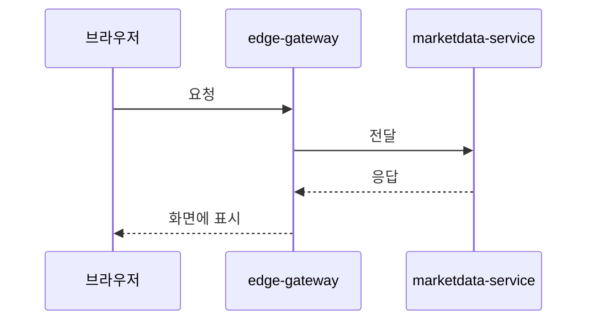
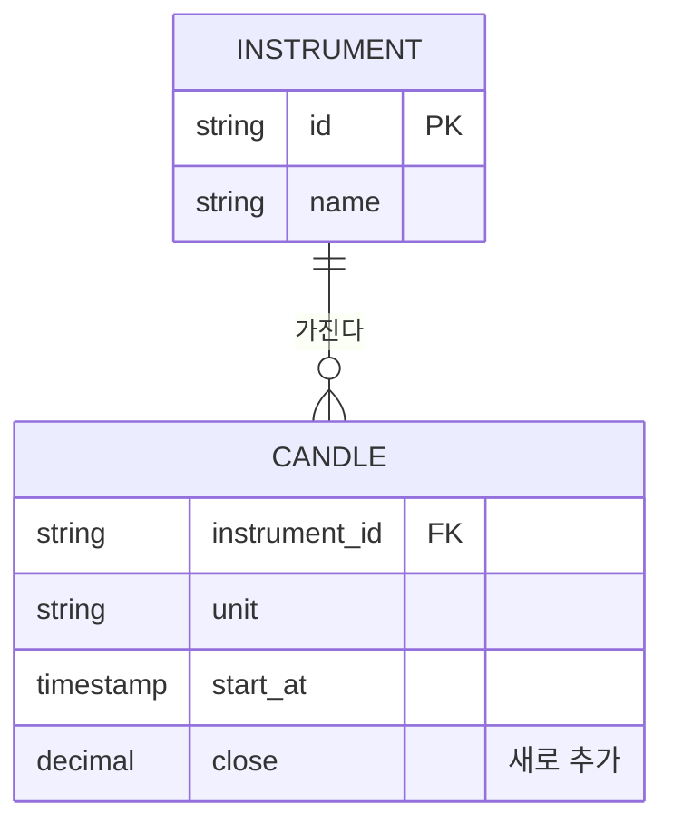

# <작업 이름> 계획서

- 상태: 검토 대기
- 종류: 변경 | 생성
- 작업 브랜치: `worktree-<작업이름>`
- 작성일: YYYY-MM-DD

<!-- 상태는 사용자가 확정하면 "확정 (YYYY-MM-DD)"로 바꾼다.
     종류: 이미 있는 화면·동작을 고치면 "변경", 없던 것을 만들면 "생성". 보고서 형식이 이것으로 정해진다. -->

## 1. 한눈에 보기

코드를 모르는 사람도 이해할 수 있게 3~5문장으로 쓴다. 무엇을 왜 하는지, 끝나면 사용자가 화면에서 무엇을 보게 되는지.

## 2. 지금은 어떻게 동작하나

이 작업이 닿는 부분의 현재 동작을 짧게 설명한다. 근거가 되는 파일을 링크한다(`backend/services/.../Foo.kt`). "생성"이라 관련 동작이 없으면 새 기능이 붙을 자리를 설명한다.

## 3. 로직 다이어그램

요청이 들어와 결과가 나갈 때까지의 흐름을 그린다. 순서가 중요하면 `sequenceDiagram`, 갈림길이 중요하면 `flowchart`를 쓴다. 이번에 새로 생기거나 바뀌는 단계는 라벨에 `(새로 추가)` / `(변경)`을 붙인다.

다이어그램 아래에 단계별 설명을 번호로 적는다.

## 4. ER 다이어그램

이 작업이 읽거나 쓰는 데이터의 관계를 그린다. 실제 테이블·컬럼 이름을 쓰고, 바뀌는 것은 설명에 `새로 추가` / `변경`을 적는다. 스키마를 바꾸지 않는 작업이면 이 작업이 다루는 테이블(또는 서비스 사이를 오가는 메시지)을 그리고 "스키마 변경 없음"이라고 쓴다.

다이어그램 아래에 바뀌는 점과 기존 데이터 처리(마이그레이션이 필요한지)를 적는다.

## 5. 세부 설계

### 5.1 바꾸는 파일

| 파일 | 새로 만듦 / 고침 | 하는 일 |
|---|---|---|
| `경로/파일` | 고침 | 무엇을 어떻게 바꾸는지 |

### 5.2 구현 순서

구현하는 사람이 그대로 따라갈 수 있게 단계로 나눈다. 단계마다 무엇을 만들고, 그 단계가 끝났는지 어떻게 확인하는지 적는다.

1. …
2. …

### 5.3 예외와 경계 상황

잘못된 입력, 빈 데이터, 서버 한 대가 죽었을 때, 동시에 일어나는 요청처럼 평소와 다른 경우에 어떻게 동작해야 하는지.

## 6. 테스트 후보

구현이 끝난 뒤 사용자에게 확인받을 테스트 목록의 초안이다.

| 확인하려는 것 | 종류 (단위 / 통합) | 위치 |
|---|---|---|
| … | 단위 | `경로/FooTest.kt` |

## 7. E2E 시나리오와 캡처할 화면

전체를 띄운 뒤 실제 사용자처럼 따라 할 순서다. 단계마다 기대하는 결과와 캡처할 화면을 적는다. "변경" 작업이면 같은 화면을 고치기 전에도 캡처한다.

| 순서 | 사용자가 하는 일 | 기대하는 결과 | 캡처 파일 | 전 화면도 캡처 |
|---|---|---|---|---|
| 1 | … | … | `01-….png` | 예 / 아니오 |

## 8. 하지 않는 것

이번 작업 범위에 넣지 않는 것과 이유.

## 9. 확인이 필요한 결정

사용자만 정할 수 있는 것. 선택지와 추천을 함께 적는다. 없으면 "없음".

| 결정할 것 | 선택지 | 추천과 이유 |
|---|---|---|
| … | A / B | A. … |
