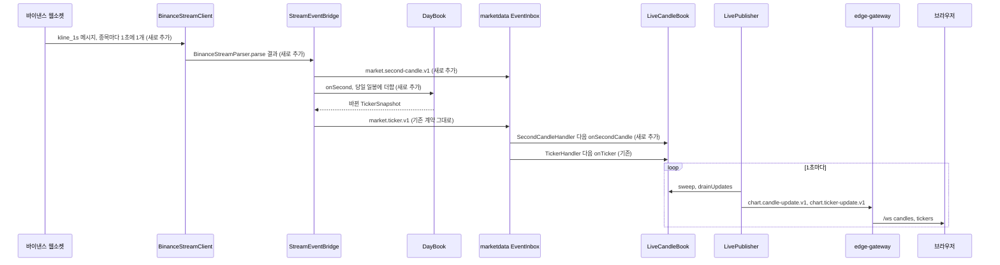
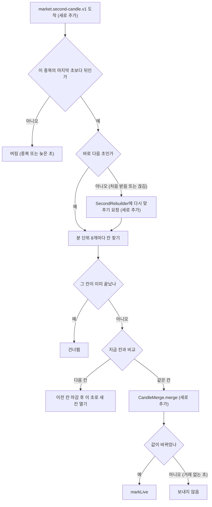
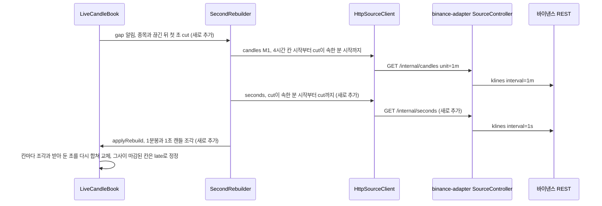
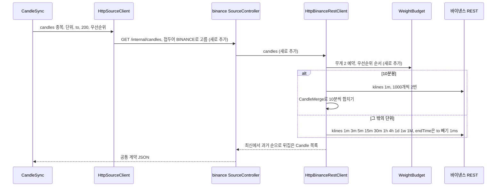
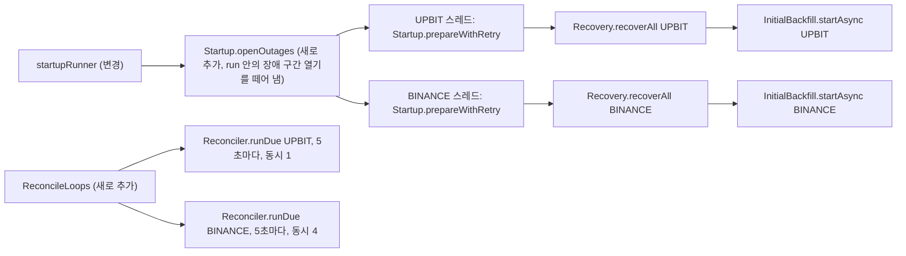
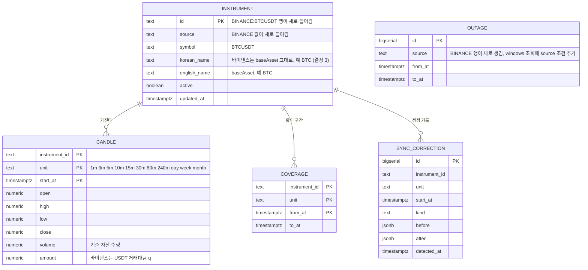
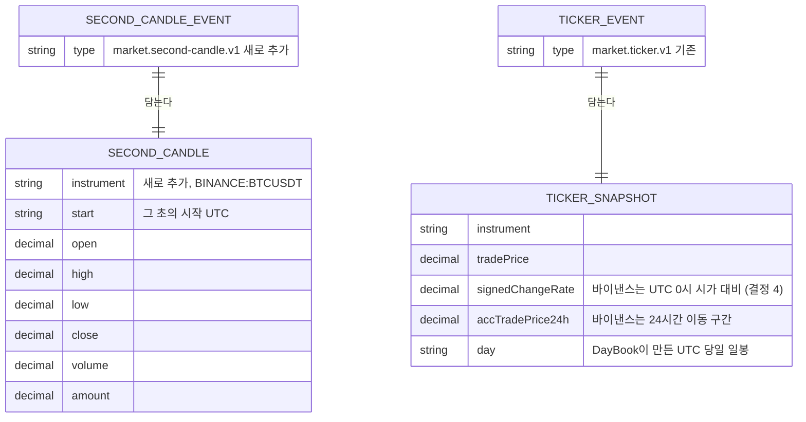

# 바이낸스 시세 연동 (binance-adapter) 계획서

- 상태: 확정 (2026-11-10)
- 종류: 생성
- 작업 브랜치: `worktree-binance-adapter`
- 작성일: 2026-11-10

## 1. 한눈에 보기

지금 차트는 업비트 시세만 보여 준다. 이번 작업은 바이낸스 현물 시장의 USDT 종목 518개를 함께 붙여, 화면에서 `BTCUSDT` 같은 바이낸스 종목을 골라 업비트와 똑같은 11개 단위(1·3·5·10·15·30·60·240분, 일·주·월)로 볼 수 있게 한다. 바이낸스를 고른 이유는 **1초마다 마감되는 1초 캔들을 실시간으로 보내 주기 때문**이다. 거래가 드문 종목도 매초 한 번씩 오므로 진행 중 캔들이 1초 단위로 정확하게 움직인다(Bybit은 1초 캔들이 없고 실시간 갱신이 1.5~3초 간격이라 이번에는 뺐다). 업비트는 지금처럼 그대로 동작하고, 가격은 원화로 바꾸지 않고 USDT 그대로 보여 준다. 끝나면 종목 목록에서 바이낸스 종목을 골라 1초마다 움직이는 차트를 볼 수 있고, 지난 캔들은 바이낸스 공식 데이터와 값이 똑같다.

## 2. 지금은 어떻게 동작하나

**전체 구조.** 업비트 어댑터([`backend/services/upbit-adapter`](../../../backend/services/upbit-adapter))가 업비트 웹소켓을 받아 공통 이벤트(`market.*`)로 바꿔 marketdata에 보내고, marketdata는 `/internal/*` 조회 API(공통 계약)로 과거 캔들을 받는다. 어떤 어댑터를 부를지는 종목 ID 앞부분(`UPBIT:`)으로 고른다([`source/SourceClient.kt`](../../../backend/services/marketdata-service/src/main/kotlin/com/anthill/marketdata/source/SourceClient.kt)의 `baseUrls` 맵, [`application.yml`](../../../backend/services/marketdata-service/src/main/resources/application.yml)의 `anthill.sources`). 종목 ID 형식(`InstrumentId`)·DB 테이블([`V1__init.sql`](../../../backend/services/marketdata-service/src/main/resources/db/migration/V1__init.sql))에는 소스별 전제가 없어서 `BINANCE:BTCUSDT`를 그대로 넣을 수 있다.

**진행 중 캔들.** [`live/LiveCandleBook.kt`](../../../backend/services/marketdata-service/src/main/kotlin/com/anthill/marketdata/live/LiveCandleBook.kt)가 입력 세 가지로 진행 중 캔들을 만든다.
- `onTrade(TradeEvent)`: 체결 하나(가격·수량·`sequentialId`)로 분 단위 8개를 갱신한다. 거래대금은 `가격 × 수량`으로 직접 계산한다.
- `onCandle(SourceCandleEvent)`: 업비트가 단위별로 보내 주는 분봉(`candle.1m`~`candle.240m`)을 "정답 값"으로 덮어쓴다.
- `onTicker(TickerSnapshot)`: 티커의 당일 값(`day`)을 일봉으로 쓰고, 주·월봉은 마감 일봉 + 오늘 일봉으로 계산한다(`recomputePeriods`).

[`live/LivePublisher.kt`](../../../backend/services/marketdata-service/src/main/kotlin/com/anthill/marketdata/live/LivePublisher.kt)가 1초마다 바뀐 칸만 `chart.candle-update.v1`, `chart.ticker-update.v1`으로 게이트웨이에 보낸다.

**바이낸스 1초 캔들을 어떻게 넣을지 (a/b 판단).** 바이낸스는 체결이 아니라 "1초 캔들"(시·고·저·종·거래량·거래대금)을 준다.
- (b) 기존 이벤트로 바꿔 넣기는 맞지 않는다. `TradeEvent`는 가격 하나라 1초 안의 고가·저가를 담지 못하고, `onTrade`는 거래대금을 `가격 × 수량`으로 계산하는데 바이낸스 거래대금(`q`)은 체결마다의 합이라 `종가 × 거래량`과 다르다. `SourceCandleEvent`로 넣으려면 어댑터가 8개 분 단위를 모두 직접 계산해 매초 단위별로 보내야 해서(518종목 × 8단위 ≈ 초당 4천 건) 이벤트가 8배가 되고 `LiveCandleBook`의 상태 기계를 어댑터에 한 벌 더 만들게 된다.
- (a) **1초 캔들을 새 이벤트(`market.second-candle.v1`)로 받아 marketdata가 합친다**로 정한다. 1초 캔들은 성격상 "1초 동안의 체결 묶음"이라 `onTrade`와 같은 자리(분 단위 8개 갱신)에 들어가는 것이 자연스럽고, 이벤트는 초당 518건이다. 일봉은 업비트와 같은 길(티커 → `onTicker`)을 쓴다: 바이낸스 어댑터가 1초 캔들로 당일 일봉을 만들어 업비트 티커와 같은 `TickerSnapshot`으로 보낸다. 그래서 일·주·월봉과 종목 목록 시세 쪽 marketdata 코드는 바꾸지 않는다.

**정합성 검사·복구·과거 채우기에 깔린 업비트 전제.**
- [`sync/Reconciler.kt`](../../../backend/services/marketdata-service/src/main/kotlin/com/anthill/marketdata/sync/Reconciler.kt) `runDue()`는 모든 소스의 (종목, 단위)를 한 줄로 차례대로 처리하고, [`sync/ReconcilePlanner.kt`](../../../backend/services/marketdata-service/src/main/kotlin/com/anthill/marketdata/sync/ReconcilePlanner.kt)는 24시간 거래대금 큰 순으로 정렬한다. 원화와 USDT 금액이 한 줄에서 비교되고, 업비트 요청(초당 9회 예산)이 바이낸스 검사를 붙잡는다. 바이낸스만 해도 분당 약 900건(518종목 × 단위별 빈도 합 ≈ 1.75)이라 한 줄로 돌리면 1분봉 검사 시한(마감 후 5분)을 넘길 수 있다.
- [`sync/InitialBackfill.kt`](../../../backend/services/marketdata-service/src/main/kotlin/com/anthill/marketdata/sync/InitialBackfill.kt)도 모든 소스 종목을 거래대금 순 한 줄로 돌고, [`sync/Recovery.kt`](../../../backend/services/marketdata-service/src/main/kotlin/com/anthill/marketdata/sync/Recovery.kt)는 복구 중 정합성 검사를 소스 구분 없이 통째로 멈춘다(`reconciler.pause()`).
- [`sync/Startup.kt`](../../../backend/services/marketdata-service/src/main/kotlin/com/anthill/marketdata/sync/Startup.kt) `run()`은 소스를 차례대로 준비하고, 모두 끝나야 복구를 부른다([`config/MarketdataConfig.kt`](../../../backend/services/marketdata-service/src/main/kotlin/com/anthill/marketdata/config/MarketdataConfig.kt) `startupRunner`). 바이낸스 어댑터가 안 뜨면(예: 미국 IP 차단) 업비트 복구까지 영영 멈춘다.
- [`sync/OutageLog.kt`](../../../backend/services/marketdata-service/src/main/kotlin/com/anthill/marketdata/sync/OutageLog.kt) `windows()`는 소스를 가리지 않아, 한 소스의 장애 구간이 다른 소스의 시한 판정을 가린다.
- [`tools/VerifyCandlesRunner.kt`](../../../backend/services/marketdata-service/src/main/kotlin/com/anthill/marketdata/tools/VerifyCandlesRunner.kt)는 모든 소스 티커를 거래대금으로 한 줄 정렬해 상·하위 5개를 뽑는다(원화가 숫자상 커서 업비트만 뽑힌다).
- [`candle/CandleSync.kt`](../../../backend/services/marketdata-service/src/main/kotlin/com/anthill/marketdata/candle/CandleSync.kt)는 소스가 주지 않은 캔들을 지운다(업비트는 거래 없는 분에 캔들이 없다). 바이낸스는 거래 없는 분에도 캔들을 주므로(o=h=l=c=직전 종가, 거래량 0) 그대로 맞는다. 페이지 크기 `PAGE = 200`, `to` 배타, 최신→과거 순이라는 계약은 바이낸스 어댑터가 맞춰 준다.

**화면의 업비트 전제.** [`frontend/src/markets/MarketList.tsx`](../../../frontend/src/markets/MarketList.tsx)는 `koreanName`을 굵게 보여 주고 전체를 한 목록(서버가 준 거래대금 순)으로 보여 준다. [`frontend/src/chart/format.ts`](../../../frontend/src/chart/format.ts) `formatAmount24h`는 원화 전제("N백만", 정수 반올림)라 USDT 소액 종목은 모두 "0백만"이 된다. 가격 표시(`groupDigits`, `pricePrecision` 최대 소수 8자리)는 원화 전제가 없어 그대로 쓸 수 있다. [`App.tsx`](../../../frontend/src/App.tsx) 첫 종목은 `UPBIT:KRW-BTC`이다. 바이낸스는 한국어 종목 이름을 주지 않는다(`exchangeInfo`에는 `baseAsset`만 있다).

**바이낸스 API 확인 결과 (2026-11-10 실측).**
- REST `GET /api/v3/klines`: 1초 단위(`1s`) 포함 1s,1m,3m,5m,15m,30m,1h,2h,4h,6h,8h,12h,1d,3d,1w,1M. **10분 단위는 없다** → 1분봉을 합쳐 만든다. `endTime`은 "시작 시각 ≤ endTime"이라 포함이다(배타로 쓰려면 `to − 1ms`). 결과는 과거→최신 순. 주봉은 월요일 00:00 UTC 시작, 월봉 1일, 일봉 00:00 UTC로 `CandleUnit` 경계와 같다. 응답 헤더 `X-MBX-USED-WEIGHT-1M`에 쓴 무게가 온다.
- **합치는 규칙(실측으로 확인):** 큰 캔들의 시가는 "첫 거래가 있는 조각의 시가"이고, 고가·저가도 거래 있는 조각만 본다. 거래 없는 조각(o=h=l=c=직전 종가)은 종가만 이어진다. 거래가 하나도 없으면 o=h=l=c=직전 종가, 거래량 0. ZILUSDT 1초 캔들 60개 → 1분봉, 1분봉 → 3분·15분봉(ZILUSDT·EURIUSDT·FDUSDUSDT)을 이 규칙으로 합치면 마감된 캔들은 바이낸스 값과 모두 같았다. 단순히 첫 조각 시가를 쓰면 1초→1분에서 15개 중 8개가 틀렸다. 거래량·거래대금 합은 정확히 같다.
- `GET /api/v3/ticker/tradingDay`(UTC 당일, 100종목씩, 종목당 무게 4·요청당 최대 200): 당일 시·고·저·종·거래량·거래대금과 `lastId`(당일 마지막 체결 번호)를 준다. `GET /api/v3/ticker/24hr?type=MINI`(전 종목, 무게 80): 24시간 이동 구간 거래대금.
- 웹소켓 `kline_1s`: 메시지는 모두 마감(`x=true`)으로 1초마다 왔고 중복은 없었다. 각 메시지에 그 초의 첫·마지막 체결 번호(`k.f`, `k.L`)가 있다. 이 컴퓨터 시계는 바이낸스보다 약 2초 늦었다(시계 차이 주의).

## 3. 로직 다이어그램

### 3.1 실시간: 1초 캔들이 화면에 닿기까지

1. `BinanceStreamClient`가 웹소켓 하나로 USDT 종목 전체의 `<symbol>@kline_1s`를 구독한다.
2. `BinanceStreamParser`가 마감된(`x=true`) 1초 캔들만 `SecondCandle`로 바꾼다.
3. `StreamEventBridge`가 `market.second-candle.v1`(key = 종목 ID)을 보낸다.
4. 같은 1초 캔들을 `DayBook`이 당일 일봉에 더하고, 값이 바뀌면 업비트 티커와 같은 `TickerSnapshot`을 `market.ticker.v1`으로 보낸다. 거래 없는 초는 일봉을 바꾸지 않으므로 보내지 않는다.
5. marketdata의 `SecondCandleHandler`가 `LiveCandleBook.onSecondCandle`을 부르고(3.2), 일봉·주봉·월봉은 기존 `onTicker`가 처리한다.
6. `LivePublisher`가 1초마다 바뀐 칸만 게이트웨이로 보낸다(기존 그대로).

### 3.2 `LiveCandleBook.onSecondCandle` 판단 흐름

1. 종목별로 마지막으로 반영한 초(`lastSecond`)를 기억한다. 같거나 이른 초는 버린다(어댑터 재연결·이중화 때 중복 방지).
2. 처음 받은 종목이거나 초가 건너뛰어졌으면(끊김) 그 종목을 `SecondRebuilder`에 맡겨 지금 열린 칸을 바이낸스 REST로 다시 맞춘다(3.3). 그동안에도 받은 초는 계속 반영한다.
3. 분 단위 8개 각각에 대해 `onTrade`와 같은 방식으로 칸을 열고 닫되, 값 합치기는 `CandleMerge.merge`(2절의 바이낸스 규칙)를 쓴다.
4. 거래 없는 초는 값을 바꾸지 않으므로 화면에 보내지 않는다. 다만 칸이 없으면 그 초로 칸을 연다(o=h=l=c=직전 종가, 거래량 0). 바이낸스 REST의 "거래 없는 분" 캔들과 같은 값이다.

### 3.3 끊김 뒤 진행 중 캔들 다시 맞추기 (marketdata가 새로 시작할 때 포함)

1. 진행 중인 칸 중 가장 이른 시작은 4시간 칸 시작(`CandleUnit.M240.floor(cut)`)이다. 그 시점부터 `cut`이 속한 분 시작까지는 1분봉(최대 240개, 요청 1~2번), 분 시작부터 `cut` 직전까지는 1초 캔들(최대 59개, 요청 1번)로 받는다. 이 조각들과 `cut` 이후에 받아 둔 초를 차례로 합치면 모든 분 단위 칸이 바이낸스와 같아진다.
2. 다시 맞추는 동안 마감된 칸이 있으면 다시 계산한 값을 `late()`로 넘겨 저장·정정 푸시한다(기존 `ClosedCandleSink` 경로).

### 3.4 과거 캔들 조회 (10분봉 포함)

### 3.5 소스별로 따로 도는 시작·복구·검사 (변경)

1. 장애 구간을 먼저 열고, 소스마다 따로 준비 → 복구 → 과거 채우기를 한다. 한 소스가 안 떠도 다른 소스는 진행한다.
2. 정합성 검사도 소스마다 자기 반복을 가진다. 복구 중 멈춤(`pause`)도 그 소스만 멈춘다. 바이낸스는 요청이 많아 동시에 4개씩 처리한다(무게 예산은 어댑터가 지킨다).

## 4. ER 다이어그램

서비스 사이를 오가는 메시지 (공통 계약 `libs/market-contract`):

- **스키마 변경 없음.** 바이낸스 종목·캔들은 기존 테이블에 `BINANCE:` 접두어 행으로 들어간다. 마이그레이션은 필요 없고, 기존 업비트 데이터는 건드리지 않는다.
- 새 메시지는 `SecondCandle`/`SecondCandleEvent`(`market.second-candle.v1`) 하나다. 기존 구독 설정(`types: ["market."]`)이 접두어로 받으므로 이벤트 전송 설정은 바꾸지 않는다.
- `CandleUnit`에 1초 단위를 넣지 않는다. `CandleUnit.entries`를 도는 검사·복구·대조·화면 단위가 모두 영향을 받기 때문이다.

## 5. 세부 설계

### 5.1 바꾸는 파일

**공통 계약 `backend/libs/market-contract`**

| 파일 | 새로 만듦 / 고침 | 하는 일 |
|---|---|---|
| `src/main/kotlin/com/anthill/contract/SourceTypes.kt` | 고침 | `data class SecondCandle(instrument, start, open, high, low, close, volume, amount)`와 `fun toCandle(unit: CandleUnit, bucket: Instant): Candle` 추가. 1초 캔들을 주는 소스만 쓴다. |
| `src/main/kotlin/com/anthill/contract/Events.kt` | 고침 | `data class SecondCandleEvent(val candle: SecondCandle)`, `EventTypes.MARKET_SECOND_CANDLE = "market.second-candle.v1"` 추가. |
| `src/main/kotlin/com/anthill/contract/CandleMerge.kt` | 새로 만듦 | `object CandleMerge { fun merge(acc: Candle, piece: Candle): Candle }`. 규칙: `piece.volume == 0`이면 `acc` 그대로; `acc.volume == 0`(아직 거래 없음)이면 시·고·저·종·거래량·거래대금을 `piece` 값으로 바꿈; 그 밖에는 고가 max, 저가 min, 종가 = `piece.close`, 거래량·거래대금 더함. 바이낸스 조각 합치기 규칙(2절)이고 어댑터(10분봉·일봉)와 marketdata(분 단위 칸·다시 맞추기)가 같이 쓴다. |
| `src/main/kotlin/com/anthill/contract/CandleUnit.kt` | 고침 | 주석만: "업비트·바이낸스와 같은 UTC 기준". |
| `src/test/kotlin/com/anthill/contract/CandleMergeTest.kt` | 새로 만듦 | 6.1 참고. |
| `src/test/kotlin/com/anthill/contract/ContractJsonTest.kt` | 고침 | `SecondCandleEvent` 왕복, 숫자는 문자열. |

**새 서비스 `backend/services/binance-adapter`** (패키지 `com.anthill.binance`, upbit-adapter와 같은 모양)

| 파일 | 새로 만듦 / 고침 | 하는 일 |
|---|---|---|
| `build.gradle.kts` | 새로 만듦 | upbit-adapter와 같은 의존성. |
| `src/main/resources/application.yml` | 새로 만듦 | `server.port: 8083`, `anthill.binance.rest-base-url: https://api.binance.com`, `ws-url: wss://stream.binance.com:9443/ws`, `weight-per-minute: 4800`(한도 6000의 80%, 같은 IP의 다른 호출 몫), `max-streams: 1000`, `anthill.stream.enabled: true`, 이벤트 구독자 `market.` → `http://localhost:8081/internal/events`. |
| `.../BinanceAdapterApplication.kt` | 새로 만듦 | `@SpringBootApplication @EnableScheduling`. |
| `.../config/AdapterConfig.kt` | 새로 만듦 | `BinanceProperties`, `EventsProperties`, 빈 연결(`clock`, `contractJsonModule`, `WeightBudget`, `HttpBinanceRestClient`, `HttpEventTransport`(producer `binance-adapter`), `StreamEventBridge`, `DayBook`, `BinanceStreamClient`, `InstrumentRefresher`), `streamStarter`(종목 받고 → `DayBook` 앵커 → 스트림 시작, 실패하면 5초 뒤 재시도, 기동은 막지 않음). 정기 작업: 상태 알림 5초, 종목 목록 10분, `DayBook` 다시 앵커 10분, 24시간 거래대금 60초. |
| `.../rest/WeightBudget.kt` | 새로 만듦 | `upbit/rest/RequestBudget`을 본뜬 분당 무게 예산. `run(priority, weight, block)`: 최근 60초 무게 합 + 이번 무게 ≤ 한도일 때만 내보내고, 기다리는 요청은 우선순위(USER > RECOVERY > RECONCILE > BACKFILL) → 도착 순. `pauseUntil(instant)`: 429·418의 `Retry-After`, 또는 `X-MBX-USED-WEIGHT-1M`이 한도의 90%를 넘으면 다음 분까지 모두 멈춤. |
| `.../rest/BinanceJson.kt` | 새로 만듦 | `SOURCE = "BINANCE"`, `id(symbol)`, kline 행 → `Candle`(행[0] 시작 ms, [1..4] 시고저종, [5] 거래량, [7] 거래대금), kline 행 → `SecondCandle`, `interval(unit)`(M1→1m, M3→3m, M5→5m, M15→15m, M30→30m, M60→1h, M240→4h, DAY→1d, WEEK→1w, MONTH→1M; M10은 없음), tradingDay 항목 → 당일 일봉. 숫자는 `BigDecimal`로 읽는다. |
| `.../rest/BinanceRestClient.kt` | 새로 만듦 | `interface BinanceRestClient`(`markets()`, `candles(symbol, unit, to, count, priority)`, `seconds(symbol, from, to, priority)`, `tradingDays(symbols)`, `amounts24h()`)와 `HttpBinanceRestClient`. `candles`: `endTime = to − 1ms`(to가 없으면 생략), `limit = count`, 결과를 뒤집어 최신→과거. **10분봉**: `M10.floor(to − 1ms)`부터 `count`개 칸을 덮는 1분봉을 `startTime`/`endTime`으로 1000개씩(최대 2번) 받아 `CandleMerge`로 10분씩 합치고, 1분봉이 하나도 없는 칸(상장 전)은 뺀다. `seconds`: `interval=1s`, `startTime=from`, `endTime=to−1ms`, 최대 1000초. `markets`: `exchangeInfo?permissions=SPOT&symbolStatus=TRADING`(무게 20) 중 `quoteAsset == "USDT"`, 심볼 순, 최대 `max-streams`개(넘으면 경고 로그). `tradingDays`: 100개씩 나눠 요청. `amounts24h`: `ticker/24hr?type=MINI`(무게 80)의 `quoteVolume`. 429는 `Retry-After`만큼 멈췄다 3번까지 재시도, 418은 멈추고 실패, 451은 "이 지역 IP는 바이낸스가 막는다" 메시지로 실패. |
| `.../api/SourceController.kt` | 새로 만듦 | `/internal/candles`(접두어 `BINANCE` 확인, count 1..200), `/internal/instruments`, `/internal/tickers`(`DayBook`이 준비됐으면 그 값, 아니면 REST로 만든 값), `/internal/stream-status`, **`/internal/seconds?instrument=&from=&to=&priority=`**(새 계약, from 포함·to 배타, 최대 1000초). 잘못된 입력은 400. |
| `.../api/AdminController.kt` | 새로 만듦 | dev 프로필 `POST /admin/stream/pause?seconds=N`(끊김 복구 시험). |
| `.../instruments/InstrumentRefresher.kt` | 새로 만듦 | 목록이 바뀌었을 때만 `stream.resubscribe` + `market.instrument.v1` 발행. `InstrumentInfo(id, koreanName, englishName)`의 이름은 둘 다 `baseAsset`(예: `BTC`). |
| `.../stream/BinanceStreamParser.kt` | 새로 만듦 | `subscribeMessages(symbols, startId)`: `{"method":"SUBSCRIBE","params":["btcusdt@kline_1s",…],"id":n}`를 200개씩; `unsubscribeMessages`; `parse(text)`: `{"result":…}`(구독 응답)은 null(오류면 경고 로그), `e == "kline"`이고 `k.i == "1s"`이고 `k.x == true`인 것만 `BinanceKlineMsg(second: SecondCandle, firstTradeId = k.f, lastTradeId = k.L)`로. |
| `.../stream/BinanceStreamClient.kt` | 새로 만듦 | `UpbitStreamClient`를 본뜬 연결 관리(백오프 1초→30초, 15초 동안 프레임 없으면 끊고 재연결, `pause`, 상태). 열린 뒤 구독 메시지를 **250ms 간격**으로 보낸다(바이낸스 제한: 연결당 들어오는 메시지 초당 5개). `resubscribe`는 지금 구독과의 차이만 SUBSCRIBE/UNSUBSCRIBE. 텍스트 프레임을 합쳐 파싱. Ping에는 JDK WebSocket이 Pong을 자동으로 보낸다(테스트로 확인). 24시간마다 서버가 끊는 것은 일반 재연결로 처리. |
| `.../stream/DayBook.kt` | 새로 만듦 | 종목별 UTC 당일 일봉. `anchor(tradingDays)`: REST 값으로 바꾸고 `lastId`를 기억한 뒤, 최근 15초 동안 받아 둔 초 중 `firstTradeId > lastId`인 것만 다시 더한다. `onSecond(msg)`: `lastTradeId ≤ lastId`면 건너뜀, `firstTradeId ≤ lastId < lastTradeId`(걸친 초)도 건너뜀, 날짜가 바뀌면 그 초로 새 일봉을 연다, 그 밖에는 `CandleMerge.merge`. 바뀌었으면 `TickerSnapshot(tradePrice = 종가, signedChangeRate, accTradePrice24h = 마지막 24시간 값, day)`를 돌려준다. `signedChangeRate = (종가 − 시가) / 시가`(소수 8자리, 결정 4). |
| `.../stream/StreamEventBridge.kt` | 새로 만듦 | kline → `market.second-candle.v1`(key 종목 ID) + `DayBook.onSecond` 결과가 있으면 `market.ticker.v1`. 연결·끊김 → `market.stream-status.v1`(key `BINANCE`). |
| `.../stream/StreamHeartbeat.kt` | 새로 만듦 | upbit와 같음(5초마다 상태 재알림). |
| `src/test/...` | 새로 만듦 | 6.2 참고. `rest/FixtureServer.kt`(경로 `/api/v3/`), `stream/FakeWebSocket.kt`는 upbit 것을 복사해 쓴다. 고정 응답은 `src/test/resources/binance/`(실제 응답을 한 번 받아 저장). |
| `src/test/resources/application.properties` | 새로 만듦 | `anthill.stream.enabled=false`, `anthill.events.enabled=false`. |

**marketdata-service**

| 파일 | 새로 만듦 / 고침 | 하는 일 |
|---|---|---|
| `live/LiveCandleBook.kt` | 고침 | `onSecondCandle(e: SecondCandleEvent)`(3.2), 종목별 `lastSecond`, 끊김 알림 생성자 인자 `onSecondGap: (InstrumentId, Instant) -> Unit = { _, _ -> }`, 다시 맞추는 동안 받은 초 보관(종목당 최대 600개, 넘으면 다시 맞추기 포기), `applyRebuild(i, cut, minutes: List<Candle>, seconds: List<SecondCandle>)`(3.3). 업비트 경로(`onTrade`·`onCandle`·`onTicker`)는 바꾸지 않는다. 클래스 주석에 바이낸스 경로 설명 추가. |
| `live/SecondRebuilder.kt` | 새로 만듦 | `request(i, cut)`: 종목별로 하나만 대기(새 cut이 오면 바꿈), 동시 4개(가상 스레드 + 세마포어). `SourceClient.candles(i, M1, …, Priority.RECOVERY)`(페이지 1~2번) + `SourceClient.seconds(i, …)` → `book.applyRebuild`. 실패하면 5초 뒤 한 번 더, 그래도 실패하면 로그만(마감 캔들은 정합성 검사가 고친다). |
| `ingest/Handlers.kt` | 고침 | `SecondCandleHandler(book, tracker)`: `tracker.touch(source, occurredAt)` 후 `book.onSecondCandle`. |
| `source/SourceClient.kt` | 고침 | `fun seconds(instrument, from, to, priority): List<SecondCandle>` 추가 → `GET /internal/seconds`. |
| `config/MarketdataConfig.kt` | 고침 | `SecondCandleHandler`를 `EventInbox`에 등록, `SecondRebuilder` 빈과 `LiveCandleBook`의 `onSecondGap` 연결(순환은 `ObjectProvider`로 끊음, 기존 persister와 같은 방식), `ReconcileProperties(parallelism: Map<String, Int>)`, `startupRunner`를 소스별로(3.5), `LiveTickSchedule.reconcile` 제거 → `ReconcileLoops`(소스마다 가상 스레드 단일 스케줄러, 5초 고정 지연, 종료 시 닫음). |
| `sync/Startup.kt` | 고침 | `run(onReady: (String) -> Unit = {})`: 장애 구간을 먼저 열고(지금 `run()` 안의 `outages.open` 반복을 새 함수 `openOutages()`로 떼어 냄), 소스마다 스레드에서 `prepareWithRetry` → `onReady(source)`, 모두 끝날 때까지 기다린다(기존 테스트 호환). |
| `sync/Reconciler.kt` | 고침 | `runDue(source: String)`: 그 소스 종목만, `parallelism(source)`개씩 동시에(순서는 planner 순서대로 큐에서 꺼냄). `pause(source)`/`resume(source)`. 지표 `anthill.reconcile.overdue`·`lag.seconds`·`late`에 `source` 태그 추가. 장애 구간은 그 소스 것만 본다. |
| `sync/Recovery.kt` | 고침 | `reconciler.pause(source)`/`resume(source)`, `backfill.startAsync(source)`. |
| `sync/InitialBackfill.kt` | 고침 | `startAsync(source)`/`runOnce(source)`: 소스마다 따로 돌고(실행 중 표시도 소스별), 그 소스 종목만 그 소스 거래대금 순. |
| `sync/OutageLog.kt` | 고침 | `windows(from, to, source: String? = null)`: source가 있으면 그 소스만. |
| `tools/VerifyCandlesRunner.kt` | 고침 | 표본을 소스마다 뽑는다(소스별 거래대금 상위 5·하위 5·무작위 5). `--anthill.verify.source=BINANCE`로 한 소스만 볼 수 있게. `CandleVerifier`는 종목의 소스 장애 구간만 본다. |
| `src/main/resources/application.yml` | 고침 | `anthill.sources.BINANCE: http://localhost:8083`, `anthill.reconcile.parallelism: { UPBIT: 1, BINANCE: 4 }`. |
| `src/test/.../FakeSource.kt` | 고침 | `seconds()` 구현(넣어 둔 1초 캔들 반환, 호출 기록). |
| `src/test/...` | 고침·새로 만듦 | 6.3 참고. |

**프론트엔드**

| 파일 | 새로 만듦 / 고침 | 하는 일 |
|---|---|---|
| `frontend/src/chart/format.ts` | 고침 | `quoteOf(market)`: `UPBIT:KRW-…` → `KRW`, `BINANCE:…USDT` → `USDT`. `formatAmount24h(amount, market)`: KRW는 지금 그대로, USDT는 백만 단위 소수 둘째 자리(`435.85백만`, `0.12백만`, 결정 5). |
| `frontend/src/markets/filter.ts` | 새로 만듦 | `filterMarkets(markets, source, query)`: 탭(소스)과 검색어로 거르는 순수 함수(지금 `MarketList`의 검색 로직을 옮김). |
| `frontend/src/markets/MarketList.tsx` | 고침 | (결정 1) 위에 "바이낸스 / 업비트" 탭(바이낸스가 왼쪽·처음 선택)(`role="group"`, `aria-pressed`, `.units`와 같은 모양), `filterMarkets` 사용, 거래대금에 `market` 전달. 검색 안내 문구는 그대로. |
| `frontend/src/App.tsx` | 고침 | 첫 종목을 `BINANCE:BTCUSDT`로(결정 2). |
| `frontend/src/index.css` | 고침 | 탭 모양(`.source-tabs`). |
| `frontend/src/chart/format.test.ts`, `frontend/src/markets/filter.test.ts` | 고침·새로 만듦 | 6.4 참고. |

**실행·도구·문서**

| 파일 | 새로 만듦 / 고침 | 하는 일 |
|---|---|---|
| `backend/settings.gradle.kts` | 고침 | `"services:binance-adapter"` 추가. |
| `backend/docker-compose.yml` | 고침 | `binance-adapter` 서비스(이미지 `anthill/binance-adapter:dev`, `SPRING_PROFILES_ACTIVE: dev`, 이벤트 구독자 `http://marketdata-service:8081/internal/events`, 포트 8083). marketdata의 `SPRING_APPLICATION_JSON` `sources`에 `"BINANCE":"http://binance-adapter:8083"` 추가. 위쪽 주석 "세 서비스" → "네 서비스". |
| `backend/Dockerfile` | 고침 | 주석만("세 서비스" → "서비스들"). 빌드 방식은 `SERVICE` 인자라 그대로. |
| `scripts/compare-live.mjs` | 고침 | `--source upbit|binance`(기본 upbit). binance면 기준을 바이낸스 웹소켓 `wss://stream.binance.com:9443/stream?streams=<symbol>@kline_1m/…`으로 바꾸고(필드 `k.o/h/l/c/v/q`, 시작 `k.t`), 우리 쪽 구독은 `BINANCE:<SYMBOL>`. 종목 자동 선택은 `/api/markets`에서 그 소스 것만. 판정 세 가지(지연 2초, 마감 값 = 그 분 마지막 마감 메시지, 거래량 넘침 없음)는 같다. |
| `.claude/skills/work-e2e/check-running.sh` | 고침 | 확인할 포트에 8083 추가. |
| `README.md` | 고침 | 구성 표에 `binance-adapter` 8083, 로컬 실행 순서에 `bootRun` 한 줄, 바이낸스 메모(미국 IP 451 차단, 무게 예산, 첫 과거 채우기 시간 약 1~1.5시간), 대조 도구 `--source binance`, 지표의 `source` 태그. |

### 5.2 구현 순서

1. **계약.** `SecondCandle`, `SecondCandleEvent`, `EventTypes.MARKET_SECOND_CANDLE`, `CandleMerge`를 만든다.
   확인: `cd backend && ./gradlew :libs:market-contract:test` 통과.
2. **binance-adapter REST.** `settings.gradle.kts`, `build.gradle.kts`, `application.yml`, `BinanceJson`, `WeightBudget`, `HttpBinanceRestClient`, `SourceController`(스트림 없이 `/internal/candles`·`/internal/seconds`·`/internal/instruments`·`/internal/tickers`). 바이낸스 실제 응답(klines 1m·15m·1s, exchangeInfo, tradingDay, 24hr MINI)을 한 번 받아 `src/test/resources/binance/`에 저장하고 고정 응답 테스트를 쓴다.
   확인: 테스트 통과. `./gradlew :services:binance-adapter:bootRun` 후 `curl 'localhost:8083/internal/candles?instrument=BINANCE:BTCUSDT&unit=10m&count=3'` 값이 바이낸스 1분봉을 손으로 합친 값과 같고, `unit=15m`이 바이낸스 15m과 같다.
3. **binance-adapter 스트림.** `BinanceStreamParser`, `BinanceStreamClient`, `DayBook`, `StreamEventBridge`, `StreamHeartbeat`, `InstrumentRefresher`, `AdminController`, `AdapterConfig`의 정기 작업.
   확인: 테스트 통과. 실제 실행에서 로그로 초당 약 518개 수신, `/internal/stream-status`가 connected, `/internal/tickers`의 BTCUSDT `day`가 바이낸스 tradingDay와 같다.
4. **marketdata 실시간.** `SecondCandleHandler`, `LiveCandleBook.onSecondCandle`, `MarketdataConfig` 등록, `application.yml`에 BINANCE 주소.
   확인: 테스트 통과. 전체를 띄우고 `/api/candles?market=BINANCE:BTCUSDT&unit=1m`의 `live`가 1초마다 바뀐다.
5. **끊김 뒤 다시 맞추기.** `SourceClient.seconds`, `SecondRebuilder`, `LiveCandleBook.applyRebuild`.
   확인: 테스트 통과. 4시간 칸 중간에 marketdata를 다시 띄운 뒤 `unit=240m`의 `live`가 바이낸스 진행 중 4h kline과 같다(1~2초 차이 안의 거래량 차이만 허용).
6. **소스별 분리.** `Startup`, `Reconciler`(+ `ReconcileLoops`, 지표 태그), `Recovery`, `InitialBackfill`, `OutageLog.windows`, `VerifyCandlesRunner`.
   확인: 테스트 통과. binance-adapter를 끈 채 marketdata를 띄워도 업비트 복구가 끝나고(`initial backfill complete` 로그가 UPBIT로 찍힘) 업비트 차트가 정상이다.
7. **화면.** `filter.ts`, `MarketList` 탭, `format.ts`, `App.tsx` 첫 종목.
   확인: `cd frontend && npx vitest run && npx tsc -b` 통과, 브라우저에서 탭 전환·검색·가격 표시 확인.
8. **실행 환경·도구·문서.** `docker-compose.yml`, `Dockerfile` 주석, `compare-live.mjs --source binance`, `check-running.sh`, `README.md`.
   확인: `docker compose up -d --build`로 네 서비스가 뜨고, `node scripts/compare-live.mjs --source binance --minutes 10`이 PASS, `--source upbit`도 여전히 PASS. 1시간 뒤 verify 프로필이 종료 코드 0.

### 5.3 예외와 경계 상황

- **바이낸스에 닿지 않음(네트워크, 451 지역 차단).** 어댑터는 5초마다 다시 시도하고 기동은 막지 않는다. `/internal/*`는 5xx를 돌려주고, marketdata는 BINANCE 준비만 재시도하며 업비트는 소스별 분리(3.5) 덕분에 영향받지 않는다.
- **429 / 418.** `Retry-After`만큼 어댑터의 모든 REST를 멈춘다. 418(IP 차단)이면 재시도하지 않고 실패를 돌려준다. marketdata의 검사·복구는 다음 차례에 다시 한다. 같은 IP에서 바이낸스를 따로 부르면 그 무게도 한도에 들어가므로 예산을 80%로 둔다.
- **24시간마다 끊김.** 재연결(1초 백오프) → 스트림 끊김/연결 알림 → marketdata가 장애 구간을 열고 닫으며 복구한다. 몇 초 빠진 초는 종목마다 "다시 맞추기"(518종목 × 요청 약 2.2번, 무게 약 2,300)로 진행 중 칸을 고치고, 그 사이 마감된 칸은 정합성 검사가 고친다.
- **marketdata 재시작.** 모든 종목의 첫 초가 "끊김"으로 보여 다시 맞추기가 돈다. 그 전까지(보통 1분 안) 진행 중 칸은 재시작 이후 값만 담는다.
- **다시 맞추기 실패.** 한 번 재시도 후 포기한다. 진행 중 칸은 다음 칸부터 정상이고, 잘못 마감된 칸은 정합성 검사(분봉은 마감 후 3분 여유)가 바이낸스 값으로 고친다.
- **같은 초가 두 번, 순서 뒤바뀜.** `lastSecond` 이하인 초는 버린다. 뒤바뀌어 건너뛴 초가 생기면 끊김으로 보고 다시 맞춘다.
- **거래 없는 초.** 값이 안 바뀌므로 푸시하지 않는다. 칸이 없을 때만 그 초로 연다(바이낸스 "거래 없는 분"과 같은 값).
- **`x=false` 메시지.** 버린다(실측에서는 오지 않았다).
- **시계 차이.** 칸이 끝났는지(`ended`)·마감(`sweep`)은 우리 시계 + 10초 여유(`closeGrace`)로 판단한다. 이 컴퓨터는 바이낸스보다 약 2초 늦었다. 10초 넘게 빠르면 초가 버려지므로 서버 시계 동기화(NTP)가 필요하다.
- **종목 변화.** 거래 정지(BREAK)되면 10분 안에 목록에서 빠지고 구독 해지, DB는 `active=false`로 데이터는 남는다. 새 상장은 구독되고 첫 초에 다시 맞추기, 정합성 검사가 첫 200개를 받는다.
- **종목이 1000개를 넘음.** 연결 하나의 한도(1024) 때문에 심볼 순 앞 1000개만 목록에 올리고 경고 로그를 남긴다(지금 518개).
- **10분봉 상장 첫 칸.** 1분봉이 일부만 있으면 있는 것만 합친다. 바이낸스에 10분봉이 없으므로 이 계산이 기준이다.
- **일봉 앵커와 걸친 초.** 앵커 순간에 걸친 1초는 건너뛰어 거래량이 아주 조금 모자랄 수 있다. 10분마다 다시 앵커하고, 마감 일봉은 정합성 검사가 고친다.
- **숫자 형식.** 바이낸스는 `"68000.01000000"`처럼 뒤에 0을 붙인다. 비교는 값 기준(`Decimals.same`), 내보낼 때는 0을 뗀다(`Decimals.format`). 아주 작은 가격(`0.00000123`)은 차트가 소수 8자리까지 보여 준다.
- **원화와 USDT 섞임.** 거래대금 정렬은 소스 안에서만 한다(검사·과거 채우기·대조 도구·화면 탭).

### 5.4 위험

- **배포 위치.** 바이낸스는 미국 IP를 막는다(HTTP 451). 배포 서버는 미국 밖 리전(예: 서울·도쿄·싱가포르)이어야 하고, 배포 전에 그 리전에서 REST와 웹소켓이 되는지 확인해야 한다.
- **검사 처리량 가정.** 바이낸스 정합성 검사는 분당 약 900건이다. 요청 하나 약 50~100ms로 보고 동시 4개로 잡았다. 실제 `anthill.reconcile.overdue{source=BINANCE}`가 0이 아니면 `anthill.reconcile.parallelism.BINANCE`를 올린다(무게 예산 안에서).
- **게이트웨이로 가는 이벤트 양.** 거래가 있는 바이낸스 종목마다 매초 분 단위 8칸 + 일·주·월 3칸이 바뀌어 초당 수천 건의 `chart.candle-update.v1`이 게이트웨이로 간다. 로컬에서는 문제없을 양이지만, 운영에서 무거우면 "보고 있는 종목만 보내기"를 따로 한다(8절).
- **첫 과거 채우기 시간.** 바이낸스 518종목 × 약 118번 요청 ≈ 6만 번이라 한 줄로 약 1~1.5시간 걸린다. 그동안에도 차트 조회는 필요한 만큼 바로 받아 온다(USER 우선순위).
- **이중화 PR #2(phase1-failover)와 합칠 때.** 그 브랜치는 모노레포 분리 전 경로를 쓴다. 겹치는 곳: `SourceClient.kt`(`baseUrls`가 주소 목록으로 바뀜 → `seconds()`도 같은 방식으로), `Startup.kt`(`isLeader` 인자 → 소스별 스레드에도 적용), `MarketdataConfig.kt`(리더만 `ReconcileLoops`·`SecondRebuilder`를 돌리게), `Handlers.kt`(`touch(…, producer)` → `SecondCandleHandler`도 같게), `LiveCandleBook.kt`(`onTicker` 거래량 역행 방지·`markAllLive`는 바이낸스와 맞는다; 어댑터 두 대가 같은 초를 보내도 `lastSecond`로 걸러진다), `StreamStatusTracker.kt`(여러 피드), `docker-compose.full.yml`(binance-adapter a/b 추가). 바이낸스 어댑터 두 대는 같은 IP의 무게 한도를 나눠 쓰므로 대당 예산을 절반으로 낮춰야 한다.

## 6. 테스트 후보

### 6.1 공통 계약

| 확인하려는 것 | 종류 (단위 / 통합) | 위치 |
|---|---|---|
| 거래 없는 조각으로 연 칸에 첫 거래 조각이 오면 시·고·저·종을 그 조각 값으로 바꾼다 | 단위 | `backend/libs/market-contract/src/test/kotlin/com/anthill/contract/CandleMergeTest.kt` |
| 거래 없는 조각은 값을 바꾸지 않는다, 거래량·거래대금은 정확히 더한다 | 단위 | 같은 파일 |
| `SecondCandleEvent` JSON 왕복, 숫자는 문자열 | 단위 | `.../contract/ContractJsonTest.kt` |

### 6.2 binance-adapter

| 확인하려는 것 | 종류 (단위 / 통합) | 위치 |
|---|---|---|
| 실제 1초 캔들 60개 → 바이낸스 1분봉, 실제 1분봉 → 15분봉과 값이 같다(고정 응답) | 단위 | `backend/services/binance-adapter/src/test/kotlin/com/anthill/binance/rest/KlineMergeFixtureTest.kt` |
| 분당 무게 한도를 넘지 않고, 높은 우선순위가 먼저, `pauseUntil` 동안 멈춘다 | 단위 | `.../binance/rest/WeightBudgetTest.kt` |
| 소수를 정확히 읽고, `to`를 `endTime = to−1ms`로 보내고, 결과를 최신→과거로 뒤집는다 | 통합(고정 응답 서버) | `.../binance/rest/BinanceRestClientTest.kt` |
| 단위별 interval 매핑(60m→1h, 240m→4h, week→1w, month→1M) | 통합(고정 응답 서버) | 같은 파일 |
| 10분봉 200개 요청은 1분봉 1000개씩 2번 요청하고 10분씩 합친다, 상장 전 칸은 뺀다 | 통합(고정 응답 서버) | 같은 파일 |
| `markets`는 USDT·TRADING만, 1000개 상한; `tradingDays`는 100개씩 나눠 요청 | 통합(고정 응답 서버) | 같은 파일 |
| 429면 `Retry-After` 뒤 재시도, 451이면 지역 차단 메시지로 실패 | 통합(고정 응답 서버) | 같은 파일 |
| kline_1s 메시지 → `SecondCandle` 정확한 값; 거래 없는 초; 구독 응답·`x=false`·다른 interval은 null | 단위 | `.../binance/stream/BinanceStreamParserTest.kt` |
| 열리면 SUBSCRIBE를 200개씩 250ms 간격으로 보낸다; `resubscribe`는 차이만 보낸다 | 단위(FakeWebSocket) | `.../binance/stream/BinanceStreamClientTest.kt` |
| 끊기면 백오프로 재연결하고 상태를 알린다; `pause`; 15초 조용하면 끊고 재연결; 조각난 텍스트 프레임 합치기 | 단위(FakeWebSocket) | 같은 파일 |
| 앵커의 `lastId` 이하·걸친 초는 건너뛰고, 다시 앵커할 때 최근 초를 재생한다 | 단위 | `.../binance/stream/DayBookTest.kt` |
| 날짜가 바뀌면 새 일봉; 변동률 계산; 거래 없는 초는 티커를 내지 않는다 | 단위 | 같은 파일 |
| 이벤트 type·key(종목 ID, 상태는 `BINANCE`) | 단위 | `.../binance/stream/StreamEventBridgeTest.kt`, `StreamHeartbeatTest.kt` |
| 목록이 바뀔 때만 재구독·발행 | 단위 | `.../binance/instruments/InstrumentRefresherTest.kt` |
| `/internal/candles` 문자열·최신 먼저, BINANCE 아닌 종목·잘못된 unit/count는 400, `/internal/seconds` 1000초 넘으면 400 | 통합(MockMvc) | `.../binance/api/SourceControllerTest.kt` |
| `/internal/stream-status`, dev `/admin/stream/pause` | 통합(MockMvc) | `.../binance/api/AdminAndStatusTest.kt` |
| 앱이 뜨고 JSON 숫자가 문자열 | 통합 | `.../binance/BinanceAdapterApplicationTests.kt` |

### 6.3 marketdata-service

| 확인하려는 것 | 종류 (단위 / 통합) | 위치 |
|---|---|---|
| 1초 캔들이 분 단위 8칸을 모두 갱신한다 | 단위 | `backend/services/marketdata-service/src/test/kotlin/com/anthill/marketdata/live/LiveCandleBookTest.kt` |
| 거래 없는 초로 연 칸에 거래 있는 초가 오면 시가가 그 초의 시가가 된다; 거래 없는 초는 푸시하지 않는다 | 단위 | 같은 파일 |
| 같은 초·이른 초는 무시; 다음 칸의 초가 오면 이전 칸을 마감한다; 끝난 칸의 초는 무시 | 단위 | 같은 파일 |
| 처음 받은 초와 건너뛴 초에서만 `onSecondGap`이 한 번 불린다 | 단위 | 같은 파일 |
| `applyRebuild`가 진행 중 칸을 조각 + 받아 둔 초로 바꾸고, 그사이 마감된 칸은 late로 넘긴다 | 단위 | 같은 파일 |
| 기존 업비트 테스트가 그대로 통과한다 | 단위 | 같은 파일 |
| 다시 맞추기가 4시간 칸 시작~분 시작 1분봉, 분 시작~cut 1초 캔들을 요청하고 결과를 넘긴다; 같은 종목 요청은 합친다; 실패하면 한 번 재시도 | 단위(FakeSource) | `.../marketdata/live/SecondRebuilderTest.kt` |
| `market.second-candle.v1` 이벤트가 `/internal/events`로 들어와 진행 중 캔들이 된다 | 통합 | `.../marketdata/ingest/EventsControllerTest.kt` |
| 한 소스가 안 떠도 다른 소스는 준비되고 `onReady`가 불린다 | 통합(PgTest) | `.../marketdata/sync/StartupTest.kt` |
| `runDue(source)`는 그 소스만; `pause(source)`는 그 소스만 멈춘다; 동시 수만큼 동시에 돈다(`FakeSource.gate`); 지표에 `source` 태그 | 통합(PgTest) | `.../marketdata/sync/ReconcilerTest.kt` |
| 다른 소스의 장애 구간은 시한 판정에서 빼지 않는다 | 통합(PgTest) | 같은 파일 |
| 복구가 그 소스 검사만 멈추고 그 소스 과거 채우기를 시작한다 | 통합(PgTest) | `.../marketdata/sync/RecoveryTest.kt` |
| 과거 채우기가 소스별로 따로 돈다 | 통합(PgTest) | `.../marketdata/sync/InitialBackfillTest.kt` |
| 대조 도구가 소스마다 표본을 뽑는다 | 단위 | `.../marketdata/tools/VerifyCandlesRunnerTest.kt` |

### 6.4 프론트엔드

| 확인하려는 것 | 종류 (단위 / 통합) | 위치 |
|---|---|---|
| `quoteOf`, USDT 거래대금 표기(결정 5), KRW 표기는 그대로 | 단위 | `frontend/src/chart/format.test.ts` |
| 탭(소스)과 검색어로 거르기, 한국어 이름·영문·코드 검색, 바이낸스 심볼은 대소문자 무관 | 단위 | `frontend/src/markets/filter.test.ts` |

### 6.5 실제 연결 확인 (E2E 단계에서 수동)

| 확인하려는 것 | 종류 (단위 / 통합) | 위치 |
|---|---|---|
| 바이낸스 kline_1m과 우리 `/ws` 비교 10분: 지연 2초 안, 마감 값 일치, 거래량 넘침 없음 | 통합(실제 연결) | `node scripts/compare-live.mjs --source binance --minutes 10` |
| 업비트 비교가 여전히 통과 | 통합(실제 연결) | `node scripts/compare-live.mjs --minutes 10` |
| 1시간 운영 뒤 DB 마감 캔들 = 바이낸스 REST | 통합(실제 연결) | verify 프로필(`--anthill.verify.source=BINANCE`) |

## 7. E2E 시나리오와 캡처할 화면

전체를 `docker compose up -d --build`로 띄우고 http://localhost:3000 에서 한다. 처음에는 시세가 채워질 때까지 1분쯤 기다린다. 화면 문구·첫 종목은 9절에서 정한 결정 기준이다.

| 순서 | 사용자가 하는 일 | 기대하는 결과 | 캡처 파일 | 전 화면도 캡처 |
|---|---|---|---|---|
| 1 | 첫 화면을 연다 | 바이낸스 탭이 눌려 있고 `BTCUSDT` 1분봉 차트, 종목 목록에 바이낸스 종목(100줄 이상)과 USDT 가격 | `01-first-screen.png` | 예 (지금은 업비트 첫 화면) |
| 2 | 아무것도 하지 않고 5초 기다린다 | 범례의 종가나 거래량이 3번 이상 바뀐다(1초 갱신) | `02-live-every-second.png` | 아니오 |
| 3 | 단위 "10분"을 누른다 | 10분봉이 빈칸 없이 그려지고 진행 중 10분봉이 움직인다 | `03-ten-minute.png` | 아니오 |
| 4 | 단위 "일", "주", "월"을 차례로 누른다 | 각 단위 캔들이 그려진다(주봉은 월요일 시작) | `04-day-week-month.png` | 아니오 |
| 5 | 목록 맨 아래(거래대금 하위) 종목을 누른다 | 거래가 드문 종목도 1분봉이 빈칸 없이 이어진다(거래 없는 분은 가로선) | `05-quiet-symbol.png` | 아니오 |
| 6 | 검색칸에 "btc"를 친다 | 바이낸스 탭에 굵게 `BTC`, 작게 `BTCUSDT`인 줄이 나온다(대소문자 무관) | `06-search-symbol.png` | 아니오 |
| 7 | 1분봉에서 지난 캔들 하나에 마우스를 올린다 | 범례의 시·고·저·종·거래량·거래대금이 바이낸스 REST 같은 분 값과 같다(스크립트가 대조) | `07-crosshair-vs-binance.png` | 아니오 |
| 8 | 차트를 왼쪽 끝까지 끈다 | 이전 200개가 앞에 붙는다 | `08-scroll-back.png` | 아니오 |
| 9 | "업비트" 탭을 누르고 `KRW-BTC`를 고른다 | 업비트 목록(원화, "백만")과 차트가 지금처럼 1초마다 움직인다 | `09-upbit-still-works.png` | 예 |
| 10 | 다시 `BTCUSDT`로 돌아와 `curl -X POST localhost:8083/admin/stream/pause?seconds=20` 실행 후 40초 기다린다 | 차트가 다시 1초마다 움직이고, 진행 중 1분봉이 바이낸스 REST 진행 중 값과 같다(다시 맞추기) | `10-after-reconnect.png` | 아니오 |

## 8. 하지 않는 것

- **Bybit 연동.** 현물 1초 캔들이 없고 실시간 갱신이 평균 1.5초·최대 3초라 "1초마다 움직이는 캔들"에 맞지 않는다.
- **원화 환산, 선물(fapi).** 사용자가 USDT 그대로로 정했고, 선물에는 1초 단위가 없다.
- **차트에 "1초" 단위 추가.** 요청은 진행 중 캔들이 1초마다 움직이는 것이지 1초봉 차트가 아니다. 넣으려면 `CandleUnit`·DB·검사 전부가 바뀐다.
- **이중화(PR #2)와 합치기.** main에 아직 없으므로 지금 구조로 만든다. 합칠 때 고칠 점은 5.4에 적었다.
- **업비트·바이낸스 어댑터 공통 코드를 라이브러리로 빼기.** 연결 관리·상태 알림 코드가 비슷하지만, 요청받지 않은 리팩터링이라 이번에는 복사해 쓴다.
- **웹소켓 여러 개(1024개 넘는 구독), 24시간 끊김 전에 새 연결을 미리 여는 것.** 지금 518개라 하나로 충분하고, 끊김은 재연결 + 다시 맞추기로 메운다.
- **게이트웨이로 보내는 이벤트 줄이기(보는 종목만 발행).** 지금 구조의 동작 방식을 바꾸는 일이라 따로 한다(5.4).
- **과거 채우기 소스 안 병렬화.** 소스별로는 나누지만 바이낸스 안에서는 한 줄로 돈다(약 1~1.5시간). 필요하면 나중에 한다.
- **`scripts/e2e-capture.mjs`(업비트 전용 캡처)와 구조 보고서(`docs/architecture/`) 고치기.** 이번 E2E는 작업폴더의 `e2e.mjs`로 한다.
- **바이낸스 종목 한국어 이름(업비트 이름 빌리기, 이름 표 관리).** 결정 3에서 심볼 그대로로 정했다.

## 9. 확인이 필요한 결정

**2026-11-10 사용자가 정함:** 1 → A(거래소 탭), 2 → A(`BINANCE:BTCUSDT`), 3 → **A(심볼 그대로, 추천과 다름)**, 4 → A(업비트와 같은 기준), 5 → A(백만 단위, 소수 둘째 자리). 3이 A라서 `MarketController`는 고치지 않고, 바이낸스 종목 이름은 `InstrumentRefresher`가 넣는 `baseAsset`(예: `BTC`) 그대로 쓴다. 한국어 이름으로는 검색되지 않는다.

이 밖에 계획 전에 정한 것: 업비트와 함께 둔다, 가격은 USDT 그대로, 종목은 USDT 현물 전체, 이중화 PR #2 없이 지금 main에서 시작한다.

| 결정할 것 | 선택지 | 추천과 이유 |
|---|---|---|
| 1. 종목 목록에서 업비트·바이낸스를 어떻게 나눌지 | A. 목록 위 "바이낸스 / 업비트" 탭, 탭마다 그 거래소 거래대금 순 / B. 한 목록에 섞고 거래소 표시만 붙임 / C. 바이낸스만 보이고 업비트는 숨김(수집은 계속) | **A.** 원화와 USDT 거래대금은 크기를 비교할 수 없어 섞으면 순서가 의미 없다. 탭이면 둘 다 쓰면서 바이낸스를 앞에 둘 수 있다. |
| 2. 첫 화면 종목 | A. `BINANCE:BTCUSDT`(바이낸스 탭) / B. 지금처럼 `UPBIT:KRW-BTC` | **A.** "일단은 바이낸스 데이터를 쓰는 형식"이라는 요청에 맞다. |
| 3. 바이낸스 종목 이름 | A. 심볼 그대로(굵게 `BTC`, 작게 `BTCUSDT`) / B. 업비트에 같은 코인이 있으면 그 한국어 이름(예: 비트코인), 없으면 심볼 / C. 이름 표를 직접 만들어 관리 | **B.** "비트코인"으로 검색할 수 있고 추가 비용이 작다(marketdata에서 이름만 붙임). 서로 다른 코인이 같은 심볼을 쓰는 드문 경우 이름이 틀릴 수 있다는 점은 감수한다. 정확성이 더 중요하면 A. |
| 4. 목록의 "전일대비"와 "거래대금" 기준 | A. 전일대비 = UTC 0시(한국 9시) 시가 대비, 거래대금 = 최근 24시간(업비트 목록과 같은 뜻) / B. 둘 다 최근 24시간 이동 구간(바이낸스 앱과 같은 숫자) / C. 둘 다 UTC 0시 이후 당일 | **A.** 업비트 목록과 같은 기준이라 탭을 바꿔도 뜻이 같고, 변동률이 차트의 일봉과 맞는다. |
| 5. USDT 거래대금 표기 | A. 업비트처럼 "백만" 단위, 소수 둘째 자리(`435.85백만`, `0.12백만`) / B. 영문 약어(`435.9M`, `1.2B`) / C. 쉼표 정수(`435,851,324`) | **A.** 지금 화면과 같은 꼴이라 낯설지 않고, 작은 종목도 0으로 뭉개지지 않는다. |
