# 바이낸스 시세 연동 (binance-adapter) 보고서

- 종류: 생성 (기존 첫 화면과 종목 목록도 바뀌어 그 두 화면은 전·후를 함께 싣는다)
- 작업 브랜치: `worktree-binance-adapter`
- 계획서: [plan.md](plan.md)
- 작성일: 2026-11-11

## 1. 결과 요약

바이낸스 현물 USDT 종목 518개를 업비트 옆에 붙였다. 새 서비스 `binance-adapter`가 바이낸스 1초 캔들(`kline_1s`)을 종목마다 매초 받아 marketdata로 보내고, marketdata가 이를 1·3·5·10·15·30·60·240분 캔들로 합친다. 그래서 거래가 드문 종목도 진행 중 캔들이 1초마다 정확히 움직인다. 화면은 "바이낸스 / 업비트" 탭으로 나뉘고 첫 화면은 `BINANCE:BTCUSDT`다. 실제 연결 E2E 10단계가 모두 통과했고, 지난 1분봉 값은 바이낸스 REST와 시·고·저·종·거래량·거래대금까지 같았다. **다만 5분 실시간 대조에서 화면 반영 지연이 2초 기준을 넘은 경우가 2.6%(최대 2.27초) 있어 그 판정은 실패다(5절).**

E2E 중에 기존 버그 하나(확인 구간 동시 저장 충돌, 3절)를 찾아 고쳤다. 바이낸스 어댑터를 미국 IP에서 띄우면 바이낸스가 막는다(HTTP 451)는 점은 배포 전에 꼭 확인해야 한다(6절).

| 항목 | 결과 |
|---|---|
| 백엔드 테스트 | 229개 통과 / 0개 실패 (market-contract 23, event-bus 8, upbit-adapter 29, binance-adapter 48, marketdata-service 109, edge-gateway 12) |
| 프론트엔드 테스트 | 32개 통과 / 0개 실패 (6개 파일), `tsc -b` 오류 없음 |
| E2E 시나리오 | 10단계 중 10단계 통과, 화면 오류 0건 |
| 실시간 대조 (`compare-live --source binance`) | **지연 기준(2초) 실패**: 467건 중 12건(2.6%)이 2초를 넘음(최대 2.27초). 마감 값 10건 모두 일치, 거래량 넘침 0 |

## 2. 화면

### 2-B. 구현된 화면 (사용자가 쓰는 순서)

#### 1. 첫 화면: 바이낸스 BTCUSDT

| 전 (main) | 후 (이 작업) |
|---|---|
| 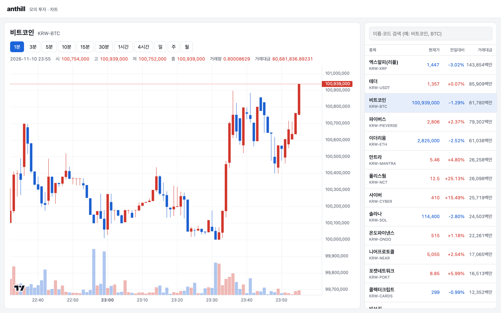 | 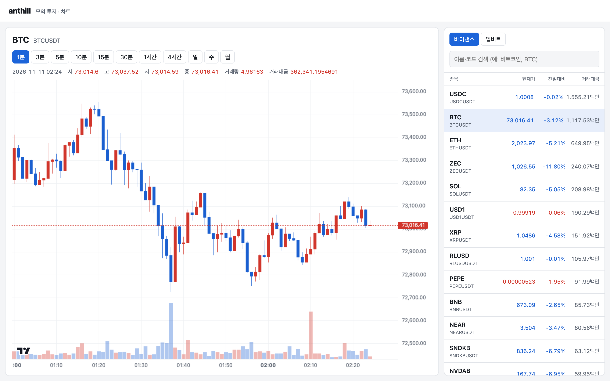 |

- 목록 위에 "바이낸스 / 업비트" 탭이 생겼고 바이낸스가 눌려 있다. 탭마다 그 거래소 종목만 그 거래소 거래대금 순으로 보인다(원화와 USDT 금액을 섞지 않으려고).
- 종목 이름은 사용자 결정대로 심볼 그대로다(굵게 `BTC`, 작게 `BTCUSDT`). 가격은 USDT 그대로, 거래대금은 `1,117.53백만`처럼 백만 단위 소수 둘째 자리다.
- 뒤에서: 화면 → edge-gateway → marketdata `/api/markets`. 바이낸스 종목 목록은 binance-adapter가 `exchangeInfo`에서 USDT·거래 중인 종목만 골라 `market.instrument.v1`로 보낸 것이다.

#### 2. 진행 중 캔들이 1초마다 움직임

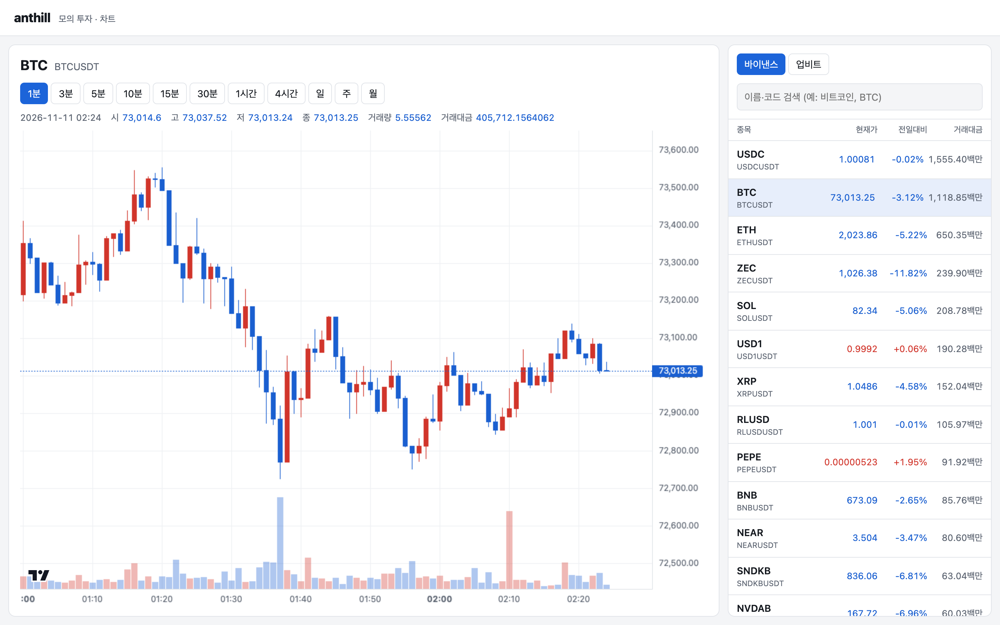

5초 동안 범례 값이 3번 넘게 바뀌었다. 바이낸스가 매초 보내는 1초 캔들 → binance-adapter `market.second-candle.v1` → marketdata `LiveCandleBook.onSecondCandle`이 분 단위 8칸을 갱신 → `LivePublisher`가 1초마다 바뀐 칸만 게이트웨이로 → 브라우저 `/ws`.

#### 3. 10분봉 (바이낸스에 없는 단위)

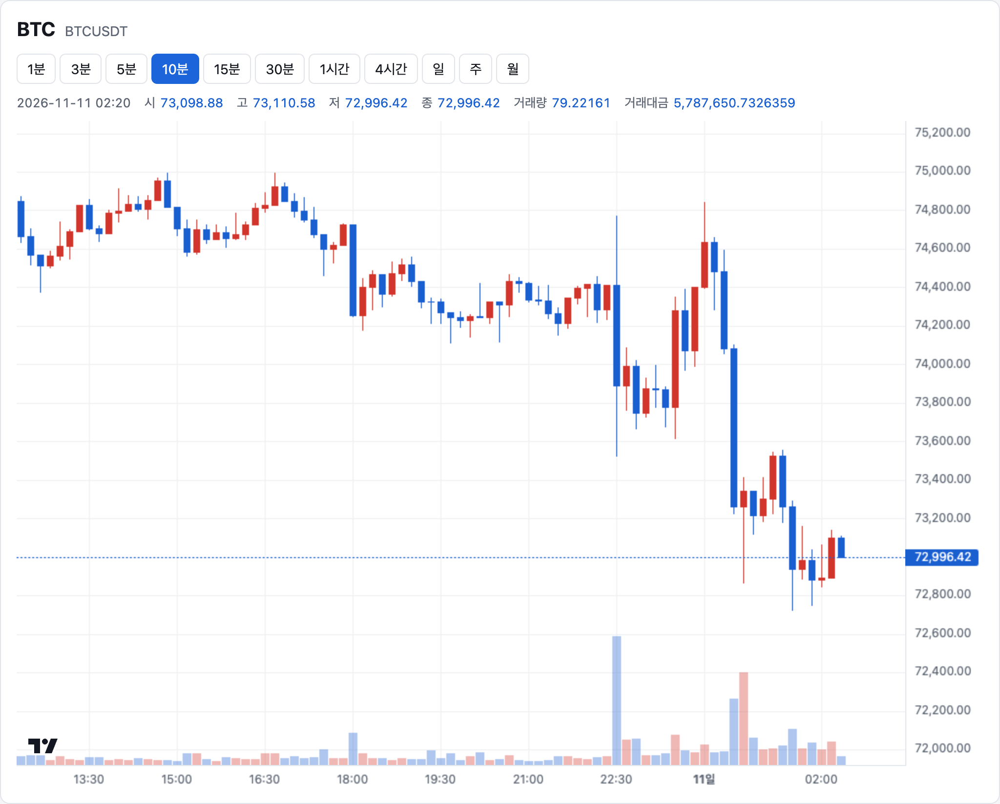

바이낸스는 10분봉을 주지 않는다. 과거 10분봉은 어댑터가 1분봉을 합쳐 만들고, 진행 중 10분봉은 marketdata가 1초 캔들로 만든다. 최근 50개가 빈칸 없이 10분 간격이었다.

#### 4. 일·주·월봉

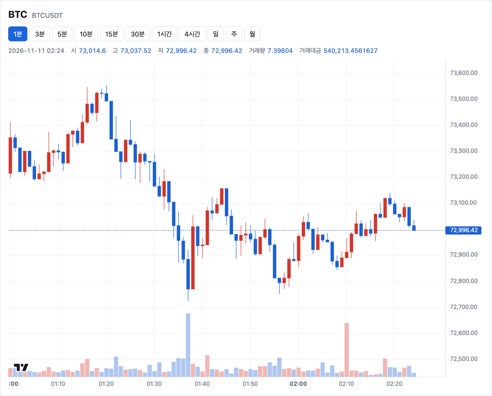

일·주·월봉이 모두 그려지고 주봉은 모두 월요일에 시작했다. 진행 중 일봉은 어댑터의 `DayBook`이 1초 캔들로 만든 당일 일봉을 업비트와 같은 티커 경로로 보낸 것이다.

#### 5. 거래가 드문 종목

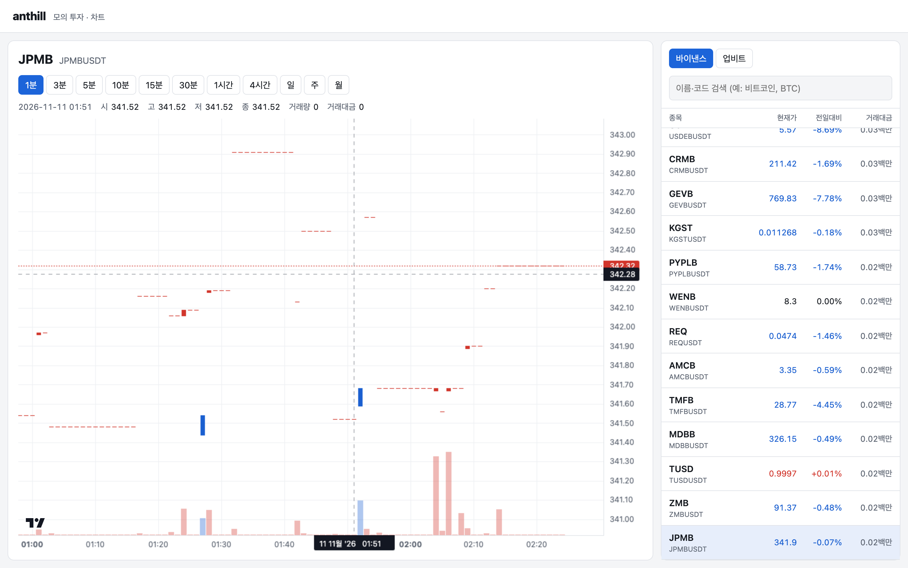

목록 맨 아래 종목(`JPMBUSDT`)도 1분봉 120개가 빈칸 없이 이어진다. 거래가 없던 분은 가로줄(시=고=저=종=직전 종가, 거래량 0)로, 바이낸스 REST의 "거래 없는 분"과 같은 값이다.

#### 6. 검색

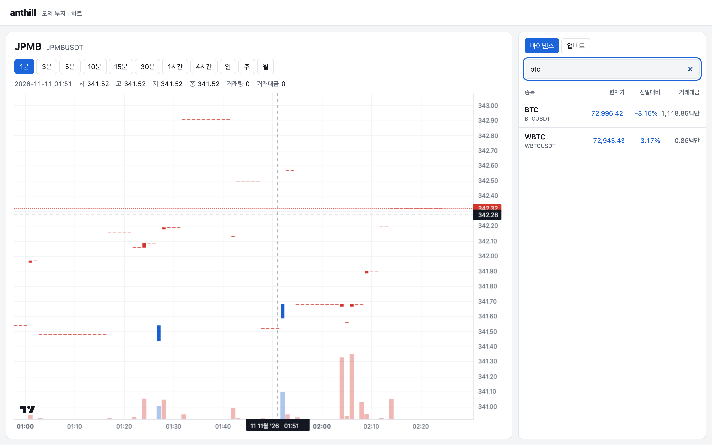

"btc"로 찾으면 `BTC / BTCUSDT`가 나온다(대소문자 무관). 이름이 심볼이라 한국어("비트코인")로는 찾을 수 없다(사용자 결정 3).

#### 7. 지난 캔들 값이 바이낸스와 같음

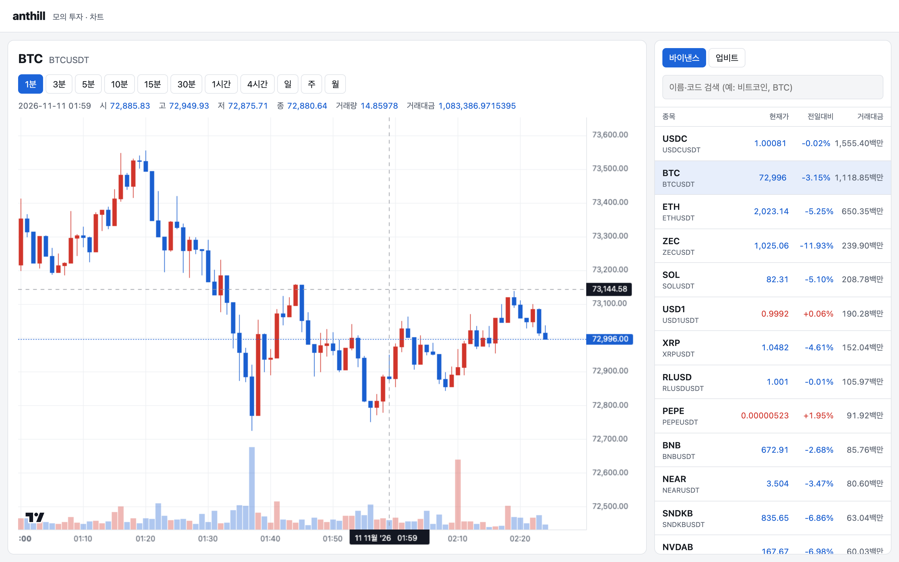

1분봉 하나에 마우스를 올린 범례 값 6개(시·고·저·종·거래량·거래대금)를 바이낸스 REST 같은 분 값과 비교해 모두 같았다.

#### 8. 과거로 넘기기

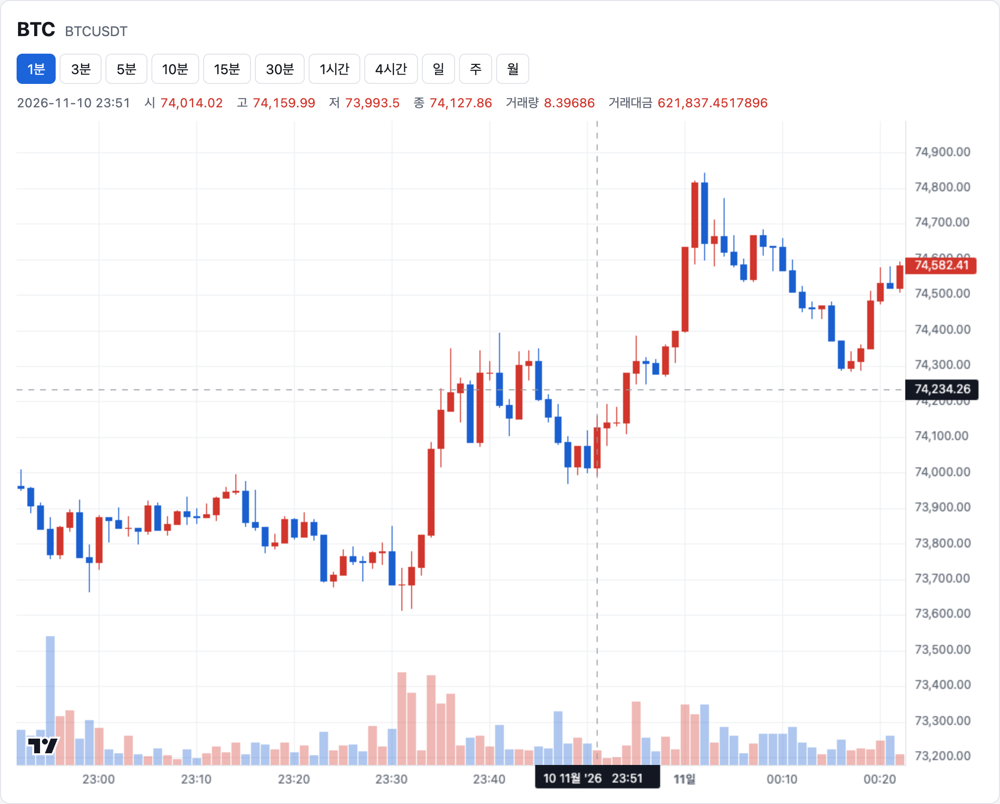

차트를 왼쪽 끝까지 밀면 이전 200개를 요청해 앞에 붙인다(기존 기능, 바이낸스 종목에서도 동작).

#### 9. 업비트는 그대로

| 전 (main) | 후 (이 작업) |
|---|---|
| 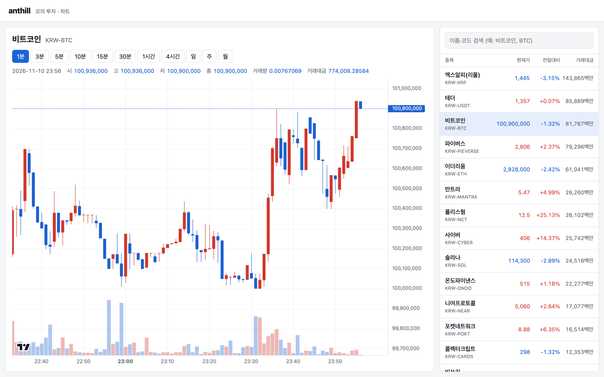 | 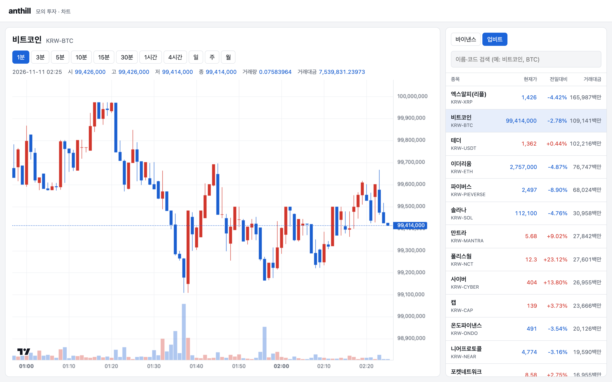 |

"업비트" 탭을 누르면 지금처럼 원화 가격, 한국어 이름, 정수 "백만" 거래대금이 나오고 `KRW-BTC` 차트가 움직인다. 업비트는 체결이 있을 때만 캔들이 움직여(밤에는 몇 초에 한 번) 이 단계의 기준은 "10초 안에 한 번 이상"으로 두었다.

#### 10. 바이낸스 연결이 끊겼다 돌아온 뒤

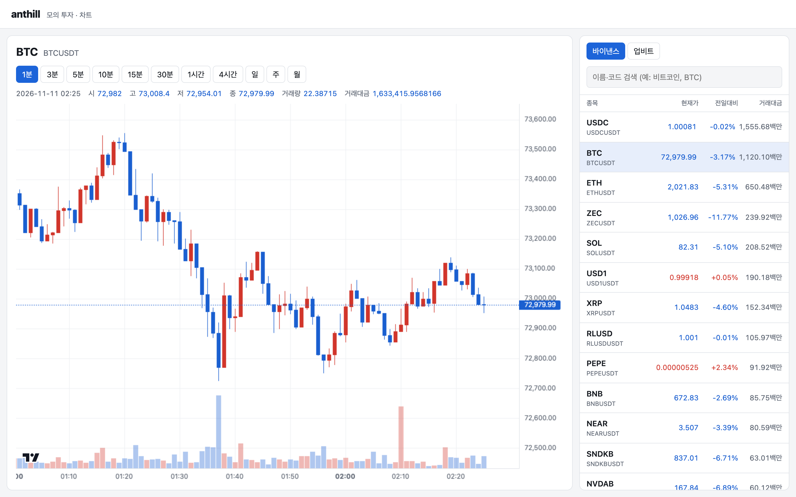

어댑터의 바이낸스 연결을 20초 끊었다가(`POST /admin/stream/pause?seconds=20`) 40초 뒤 확인했다. 차트는 다시 1초마다 움직였고, 진행 중 1분봉의 시가가 바이낸스와 같고 고·저가·거래량이 바이낸스 범위 안이었다. 끊긴 동안 빠진 초는 marketdata의 `SecondRebuilder`가 어댑터 `/internal/seconds`·`/internal/candles`로 다시 받아 진행 중 칸을 고쳤다.

## 3. 어떻게 구현했나

| 파일 | 한 일 |
|---|---|
| [`market-contract/.../SourceTypes.kt`](../../../backend/libs/market-contract/src/main/kotlin/com/anthill/contract/SourceTypes.kt), [`Events.kt`](../../../backend/libs/market-contract/src/main/kotlin/com/anthill/contract/Events.kt) | `SecondCandle`, `SecondCandleEvent`, `market.second-candle.v1` |
| [`market-contract/.../CandleMerge.kt`](../../../backend/libs/market-contract/src/main/kotlin/com/anthill/contract/CandleMerge.kt) | 조각 합치기 규칙: 시가는 "첫 거래가 있는 조각"의 시가, 거래 없는 조각은 값을 바꾸지 않음. 어댑터(10분봉·일봉)와 marketdata(진행 중 칸·다시 맞추기)가 같이 쓴다 |
| [`services/binance-adapter/`](../../../backend/services/binance-adapter) (새 서비스, 8083) | `BinanceStreamClient`(웹소켓 하나로 518개 구독, 재연결·멈춤), `BinanceStreamParser`, `DayBook`(UTC 당일 일봉), `StreamEventBridge`, `HttpBinanceRestClient`+`WeightBudget`(분당 무게 4800, 429·418·451 처리), `SourceController`(`/internal/candles·instruments·tickers·stream-status·seconds`) |
| [`marketdata/.../live/LiveCandleBook.kt`](../../../backend/services/marketdata-service/src/main/kotlin/com/anthill/marketdata/live/LiveCandleBook.kt) | `onSecondCandle`(중복·늦은 초 버림, 끊김 감지), `applyRebuild`. 업비트 경로는 그대로 |
| [`marketdata/.../live/SecondRebuilder.kt`](../../../backend/services/marketdata-service/src/main/kotlin/com/anthill/marketdata/live/SecondRebuilder.kt) | 끊긴 종목의 진행 중 칸을 어댑터 REST(1분봉 + 1초 캔들)로 다시 맞춤. 동시 4개, 실패 시 한 번 재시도 |
| [`marketdata/.../sync/`](../../../backend/services/marketdata-service/src/main/kotlin/com/anthill/marketdata/sync) (`Startup`, `Reconciler`, `ReconcileLoops`, `Recovery`, `InitialBackfill`, `OutageLog`) | 시작·복구·정합성 검사·과거 채우기를 소스(거래소)마다 따로. 바이낸스가 안 떠도 업비트는 진행. 검사 동시 수 UPBIT 1, BINANCE 4 |
| [`marketdata/.../candle/CoverageRepository.kt`](../../../backend/services/marketdata-service/src/main/kotlin/com/anthill/marketdata/candle/CoverageRepository.kt) | **(계획에 없던 수정)** 같은 (종목, 단위)의 확인 구간 추가를 트랜잭션 잠금으로 한 번에 하나씩 |
| [`frontend/src/markets/`](../../../frontend/src/markets) (`MarketList.tsx`, `filter.ts`), [`chart/format.ts`](../../../frontend/src/chart/format.ts), [`App.tsx`](../../../frontend/src/App.tsx) | 거래소 탭, USDT 거래대금 표기, 첫 종목 `BINANCE:BTCUSDT` |
| [`backend/docker-compose.yml`](../../../backend/docker-compose.yml), [`scripts/compare-live.mjs`](../../../scripts/compare-live.mjs), [`README.md`](../../../README.md) | binance-adapter 서비스 추가, 대조 도구 `--source binance`, 실행·주의 사항 |

**계획과 달라진 점**

1. **확인 구간 동시 저장 충돌 수정(계획에 없음).** E2E 4단계에서 처음 보는 월봉을 열 때 500이 났다. 과거 채우기와 화면 요청이 같은 확인 구간을 동시에 처음 넣으면, `select … for update`가 잠글 행이 없어 둘 다 insert하고 기본 키가 부딪쳤다. 원래 있던 버그로, 바이낸스 518종목을 한꺼번에 새로 채우면서 드러났다. `pg_advisory_xact_lock`으로 같은 (종목, 단위)는 한 번에 하나씩 처리하게 했고, 고치기 전에는 실패하고 고친 뒤 통과하는 테스트를 넣었다.
2. **무게 90% 판정 경계.** 테스트 단계에서 사용 무게가 정확히 5400(6000의 90%)일 때도 멈추던 것을 "넘을 때만" 멈추게 고쳤다(계획서 문구대로).
3. **어댑터 기동 순서.** "앵커 → 스트림"이 아니라 "종목 → 스트림 → 앵커"로 했다. 앵커를 먼저 하면 구독이 끝나는 1초 남짓의 체결이 다음 앵커(10분 뒤)까지 일봉에서 빠지기 때문이다.
4. **끊긴 뒤 일봉 거래량.** 재연결 직후에는 다시 앵커하지 않고 10분 주기 앵커에 맡겼다. 그래서 끊김 뒤 최대 10분 동안 당일 거래량이 끊긴 시간만큼 조금 모자란다(실측: 5초 끊김에 BTC 0.129개). 마감 일봉은 정합성 검사가 고친다.
5. **`LiveCandleBook` 생성자 인자 순서.** `onSecondGap`을 `sink` 앞에 넣었다. 기존 호출의 끝 람다가 새 인자로 가지 않게 하려고.
6. **E2E 8단계 조작 방법.** 마우스 끌기가 차트 라이브러리에 전달되지 않아 가로 휠 스크롤로 바꿨다. 보는 화면과 판정은 같다.
7. **`EventsControllerTest`의 고정 날짜.** 작업 전부터 고정 날짜(2026-11-08) 때문에 실패하던 테스트를 `Instant.now()` 기준으로 고쳤다.

## 4. 테스트

사용자가 확인한 목록(계획서 6절 + 추가 4개)대로 쓴 테스트다. 모두 통과.

| 확인한 것 | 테스트 | 결과 |
|---|---|---|
| 조각 합치기 규칙(첫 거래 조각이 시가, 거래 없는 조각 무시, 합) | `CandleMergeTest` (5개) | 통과 |
| 실제 1초 캔들 60개 → 바이낸스 1분봉, 실제 1분봉 15개 → 15분봉 | `KlineMergeFixtureTest` | 통과 |
| REST: 소수 정확히, `endTime = to−1ms`, 단위 매핑, 10분봉 합치기, 상장 첫 칸 부분 합치기, 429 재시도·418·451, 무게 90% 넘으면 다음 분까지 멈춤 | `BinanceRestClientTest` (14개) | 통과 |
| 웹소켓: 200개씩 250ms 간격 구독, 차이만 재구독, 조각 프레임, 재연결·멈춤·조용한 연결 끊기 | `BinanceStreamClientTest`, `BinanceStreamParserTest` | 통과 |
| 당일 일봉: 앵커 이전·걸친 초 건너뜀, 다시 앵커 때 재생, 날짜 바뀜, 변동률 | `DayBookTest` | 통과 |
| `/internal/*` 응답 모양·검증, 상태, dev 멈춤 | `SourceControllerTest`, `AdminAndStatusTest` | 통과 |
| 1초 캔들이 분 단위 8칸 갱신, 중복·늦은 초 무시, 끊김 감지, 다시 맞추기 반영·포기(600개 초과), 늦게 온 결과 무시 | `LiveCandleBookTest` | 통과 |
| 실제 설정 연결로 끊긴 초 → 다시 맞추기 요청 → 진행 중 칸이 REST 조각+초와 같아짐 | `EventsControllerTest.first second candle rebuilds the live candles from source minutes and seconds` | 통과 |
| 다시 맞추기 요청 범위·재시도·합치기 | `SecondRebuilderTest` | 통과 |
| 소스별 시작·복구·검사·과거 채우기·대조 표본 | `StartupTest`, `ReconcilerTest`, `RecoveryTest`, `InitialBackfillTest`, `VerifyCandlesRunnerTest` | 통과 |
| 확인 구간 동시 첫 저장이 충돌하지 않음 | `CandleStorageTest.first coverage added at the same time from many threads does not collide` | 통과 |
| 화면: USDT 거래대금 표기, 탭·검색 거르기 | `format.test.ts`, `filter.test.ts` | 통과 |

실행한 명령과 마지막 출력:

```text
$ bash .claude/skills/work-test/run-tests.sh
BUILD SUCCESSFUL in 45s
 Test Files  6 passed (6)
      Tests  32 passed (32)

=== 테스트 결과 ===
통과 | 백엔드 테스트 (gradlew test)
통과 | 프론트엔드 테스트 (vitest run, tsc -b)
```

## 5. E2E

시나리오 파일: [e2e.mjs](e2e.mjs). 이 worktree 최상위에서 `docker compose up -d`로 전체(DB, upbit-adapter, binance-adapter, marketdata, edge-gateway, frontend)를 띄우고 http://localhost:3000 에서 실행했다(2026-11-10 17:24~17:26 UTC). 결과: [shots/after/result.json](shots/after/result.json).

| 순서 | 사용자가 한 일 | 기대한 결과 | 실제 결과 | 캡처 |
|---|---|---|---|---|
| 1 | 첫 화면을 연다 | 바이낸스 탭, BTCUSDT, USDT 종목 100줄 이상 | 통과 | [01](shots/after/01-first-screen.png) |
| 2 | 5초 기다린다 | 범례가 3번 이상 바뀜 | 통과 | [02](shots/after/02-live-every-second.png) |
| 3 | "10분"을 누른다 | 빈칸 없는 10분봉, 진행 중 칸이 움직임 | 통과 | [03](shots/after/03-ten-minute.png) |
| 4 | "일·주·월"을 차례로 | 각 단위가 그려지고 주봉은 월요일 시작 | 통과 | [04](shots/after/04-day-week-month.png) |
| 5 | 목록 맨 아래 종목 | 1분봉이 빈칸 없이 이어짐 | 통과 | [05](shots/after/05-quiet-symbol.png) |
| 6 | "btc" 검색 | `BTC / BTCUSDT` 줄이 나옴 | 통과 | [06](shots/after/06-search-symbol.png) |
| 7 | 지난 1분봉에 마우스 | 범례 6개 값 = 바이낸스 REST | 통과 | [07](shots/after/07-crosshair-vs-binance.png) |
| 8 | 차트를 과거로 민다 | 이전 200개 요청 | 통과 | [08](shots/after/08-scroll-back.png) |
| 9 | 업비트 탭 → KRW-BTC | 원화·"백만", 차트가 움직임 | 통과 | [09](shots/after/09-upbit-still-works.png) |
| 10 | 바이낸스 연결 20초 끊고 40초 뒤 | 다시 1초 갱신, 진행 중 1분봉이 바이낸스와 맞음 | 통과 | [10](shots/after/10-after-reconnect.png) |

처음 두 번은 실패했고 원인을 고친 뒤 다시 돌렸다: 첫 번째는 marketdata가 막 뜬 직후라 차트 첫 요청이 실패(시나리오를 늦게 시작해 해결), 두 번째는 4단계 월봉 500(3절 1번 수정), 세 번째는 8단계 끌기 조작(3절 6번).

실시간 대조(계획서 6.5): `node scripts/compare-live.mjs --source binance --minutes 5`(BTCUSDT·ETHUSDT 등 자동 선택) 결과는 **실패(종료 코드 1)**다. 원본: [shots/after/compare-live-binance.txt](shots/after/compare-live-binance.txt).

| 판정 | 결과 |
|---|---|
| 마감 값이 바이낸스 그 분 마지막 마감 메시지와 같음 | 10건 중 10건 일치 |
| 거래량이 바이낸스보다 많아지지 않음(중복 없음) | 위반 0 |
| 바이낸스 `kline_1m` 메시지보다 2초 안에 우리 `/ws`에 같은 거래량이 보임 | 467건 중 12건 위반. 중앙값 1.15초, 95% 1.84초, 최대 2.27초 |

지연이 2초를 조금 넘는 것은 구조에서 온다. 1초 캔들은 그 초가 끝나야 오므로 최대 1초 늦고, marketdata는 1초마다 모아서 화면에 보내므로 최대 1초가 더해진다(합쳐 최대 약 2초 + 네트워크). 2초 기준은 체결을 바로 받는 업비트에 맞춰 정한 값이다. 값 자체는 정확하다. 6절에 다음 할 일로 남겼다.

## 6. 남은 것

- **실시간 지연이 2초를 조금 넘는 경우(2.6%).** 5절 실시간 대조 참고. 줄이려면 marketdata가 바이낸스 칸을 1초 주기가 아니라 1초 캔들을 받는 즉시(또는 0.5초 주기로) 보내게 바꿔야 한다. 화면으로 가는 메시지가 늘어나므로 따로 정할 일이다. 지금은 기준을 바꾸지 않고 실패로 남겼다.
- **배포 위치.** 바이낸스는 미국 IP를 막는다(HTTP 451). 배포 서버는 미국 밖 리전이어야 하고, 배포 전에 그 리전에서 REST와 웹소켓이 되는지 확인해야 한다.
- **이중화(PR #2)와 합칠 때 고칠 곳.** 계획서 5.4에 정리했다(`SourceClient`, `Startup`, `MarketdataConfig`, `Handlers`, `docker-compose.full.yml`, 어댑터 두 대의 무게 예산 절반).
- **첫 과거 채우기 시간.** 바이낸스 518종목은 약 1~1.5시간 걸린다. 그동안 차트는 필요한 만큼 바로 받아 온다. 이번 E2E에서는 끝까지 기다리지 않았다.
- **1시간 운영 뒤 마감 캔들 대조(verify 프로필, `--anthill.verify.source=BINANCE`)는 돌리지 않았다.** E2E 7단계와 실시간 대조로 일부만 확인했다.
- **게이트웨이로 가는 이벤트 양.** 거래 있는 바이낸스 종목마다 매초 여러 칸이 바뀐다. 운영에서 무거우면 "보고 있는 종목만 보내기"를 따로 한다.
- **로컬 환경 문제(작업과 무관).** 이 컴퓨터에서 `docker compose build`가 이미지를 다 만든 뒤에도 끝나지 않고 멈췄다(두 번). 30시간째 남아 있는 다른 세션의 `docker compose -p anthill-verify … build` 프로세스와 관련 있어 보인다. 이미지는 만들어졌으므로 `up -d --no-build`로 띄웠다.
