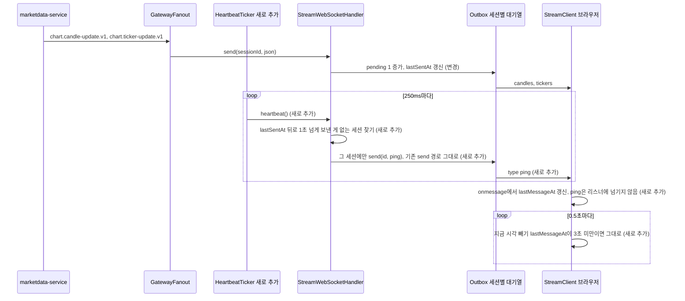
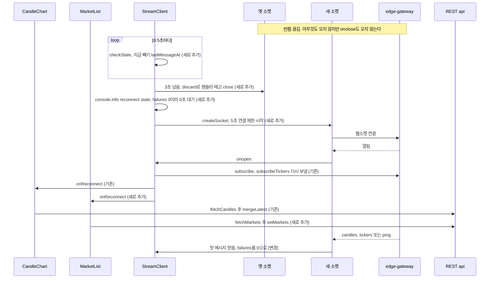
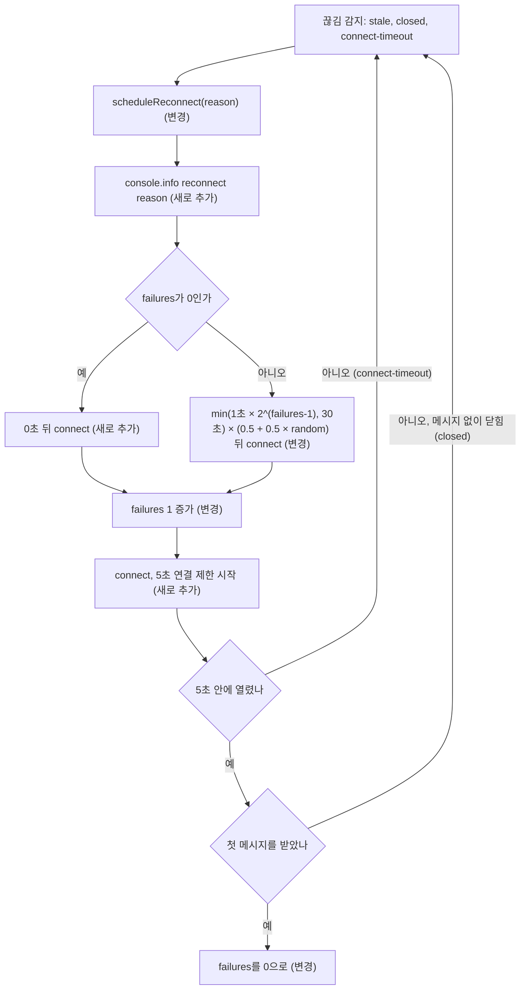
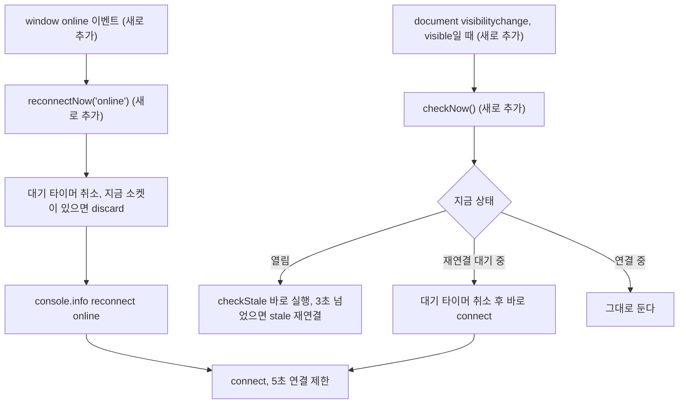
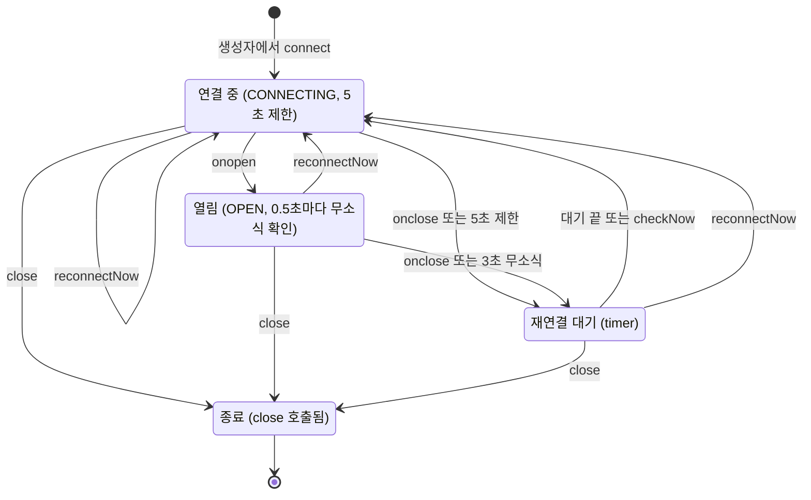
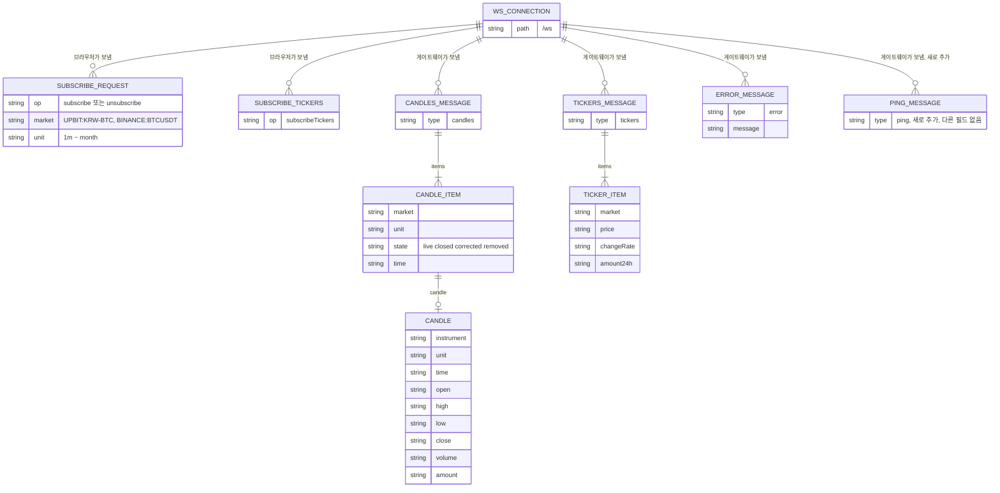
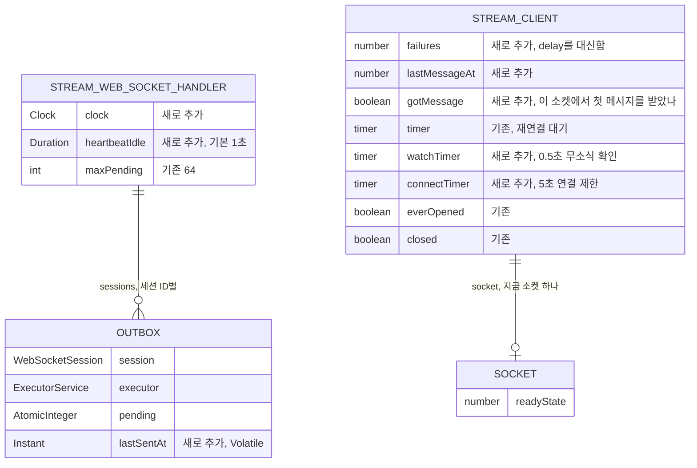

# 브라우저 실시간 연결 하트비트 (ws-heartbeat) 계획서

- 상태: 확정 (2026-11-22)
- 종류: 변경
- 작업 브랜치: `worktree-ws-heartbeat`
- 작성일: 2026-11-22

## 1. 한눈에 보기

화면의 차트와 종목 목록은 게이트웨이와 이어진 웹소켓(`/ws`) 하나로 실시간 값을 받는다. 노트북을 잠자기에서 깨우거나 와이파이를 바꾸면 이 연결이 "반쯤 끊긴" 상태가 될 수 있다. 연결은 살아 있는 것처럼 보이지만 실제로는 아무것도 오지 않는 상태다. 지금은 서버도 브라우저도 이것을 알아채지 못해서, 아무 표시 없이 옛 가격이 수 분에서 1시간까지 화면에 남는다. 이번 작업에서는 게이트웨이가 1초 동안 보낸 게 없는 연결에 짧은 신호(`ping`)를 보낸다. 브라우저는 3초 동안 아무것도 받지 못하면 연결이 끊긴 것으로 보고 곧바로 다시 연결한 뒤, 차트와 종목 목록을 최신 값으로 다시 받는다. 끝나면 옛 가격이 보이는 시간은 조용한 끊김에서 약 3~3.5초, 네트워크가 돌아오거나 탭으로 돌아온 경우에는 거의 0초가 된다. 화면 모양은 바뀌지 않는다. 연결 상태 배지는 이번 작업에 넣지 않는다.

## 2. 지금은 어떻게 동작하나

**게이트웨이 → 브라우저.** [`StreamWebSocketHandler.kt`](../../../backend/services/edge-gateway/src/main/kotlin/com/anthill/gateway/realtime/StreamWebSocketHandler.kt)가 `/ws` 연결을 관리한다.
- 연결이 열리면 `afterConnectionEstablished`(41-46행)가 세션마다 `Outbox`(33-35행)를 만든다. `Outbox`에는 세션, 세션 전용 가상 스레드 하나(`executor`), 밀린 메시지 수(`pending`)가 있다.
- 보낼 것은 모두 `send(sessionId, json)`(74-95행)을 지난다. `send`는 `pending`을 1 올려 `maxPending`(기본 64)을 넘으면 `drop`(97-101행)으로 연결을 끊는다. 넘지 않으면 세션 대기열에 넣고 바로 돌아온다.
- 보내는 것은 marketdata가 1초마다 보내 주는 캔들과 시세(`GatewayFanout`이 `handler::send`로 전달, [`GatewayConfig.kt`](../../../backend/services/edge-gateway/src/main/kotlin/com/anthill/gateway/config/GatewayConfig.kt) 56-57행), 그리고 잘못된 요청에 대한 `error` 응답뿐이다. **보낼 데이터가 없으면 연결은 조용하다. ping 같은 생존 신호는 없다.**
- 정기 작업 꼴은 [`ViewingPublisher.kt`](../../../backend/services/edge-gateway/src/main/kotlin/com/anthill/gateway/realtime/ViewingPublisher.kt)에 있다. `@Scheduled`를 단 메서드 하나가 있는 클래스이고, 빈은 `GatewayConfig.viewingPublisher`(65-67행)에서 등록한다. `@EnableScheduling`은 [`EdgeGatewayApplication.kt`](../../../backend/services/edge-gateway/src/main/kotlin/com/anthill/gateway/EdgeGatewayApplication.kt)에 이미 붙어 있다.
- `/ws` 설정은 `WsProperties`(`anthill.ws`, `GatewayConfig.kt` 29-30행)에 `allowedOrigins`와 `maxSubscriptions` 두 개만 있다.

**브라우저.** [`frontend/src/api/stream.ts`](../../../frontend/src/api/stream.ts)의 `StreamClient`가 연결 하나를 관리한다.
- `connect()`(95-113행)가 소켓을 만든다. `onopen`에서 재시도 간격을 1초로 되돌리고, 기억해 둔 구독(`subs`, `tickers`)을 다시 보낸다. 두 번째 열림부터는 `onReconnect` 리스너를 부른다.
- 다시 연결하는 계기는 `onclose` 하나뿐이다. `scheduleReconnect()`(115-123행)가 1초→2초→4초…30초 간격으로 다시 연결한다. 간격에 무작위 흔들기(지터)가 없고, 첫 재시도도 1초 기다린다.
- **"마지막으로 받은 시각"을 보지 않는다.** 반쯤 끊기면 `onclose`가 오지 않으므로 다시 연결하지 않는다. 브라우저는 보내는 것도 없어서 운영체제도 끊김을 알아채지 못한다.
- `dispatch()`(130-140행)는 `candles`, `tickers`, `error`만 처리하고 모르는 `type`은 조용히 버린다. 그래서 게이트웨이가 `ping`을 먼저 보내기 시작해도 지금 화면은 깨지지 않는다.
- `sharedStream()`(146-152행)이 화면 전체가 함께 쓰는 연결 하나를 만든다. `online`, `visibilitychange` 이벤트는 받지 않는다.

**다시 연결된 뒤 화면 맞추기.**
- 차트: [`CandleChart.tsx`](../../../frontend/src/chart/CandleChart.tsx) 201-213행의 `onReconnect`가 `fetchCandles`로 최신 페이지를 받아 `mergeLatest`로 합친다. 이 동작은 그대로 쓴다.
- 종목 목록: [`MarketList.tsx`](../../../frontend/src/markets/MarketList.tsx)는 처음 한 번만 `fetchMarkets()`를 부르고(32-57행의 `useEffect`), 그 뒤로는 `/ws` 시세로만 값을 바꾼다. **재연결해도 다시 받지 않아서 끊긴 동안 놓친 가격이 남을 수 있다.**

**중간 프록시.** 컨테이너 실행에서는 [`frontend/nginx.conf`](../../../frontend/nginx.conf) 20-28행이 `/ws`를 게이트웨이로 넘긴다. `proxy_read_timeout 1h` 때문에 게이트웨이가 아무것도 보내지 않아도 nginx는 1시간 동안 연결을 끊지 않는다. 개발 서버([`vite.config.ts`](../../../frontend/vite.config.ts))도 `/ws`를 `localhost:8080`으로 넘긴다.

## 3. 로직 다이어그램

### 3.1 평소: 보낼 게 없는 연결에만 ping

1. marketdata가 1초마다 바뀐 캔들과 시세를 보낸다. `GatewayFanout`이 구독한 세션마다 `send()`를 부른다. 이때 `send()`가 그 세션의 `lastSentAt`을 지금 시각으로 바꾼다.
2. `HeartbeatTicker.tick()`이 250ms마다 `heartbeat()`를 부른다. `heartbeat()`는 모든 세션을 돌면서 `지금 − lastSentAt ≥ heartbeatIdle(1초)`인 세션에만 `{"type":"ping"}`을 `send()`로 보낸다. 데이터가 계속 가는 세션에는 ping이 가지 않는다.
3. 250ms마다 확인하므로 정상일 때 브라우저가 받는 메시지 사이 공백은 최대 약 1.25초다(1초 + 확인 주기 0.25초). 1초마다 확인하면 최대 2초까지 벌어져 3초 판정에 너무 가까워진다.
4. 브라우저는 어떤 메시지든(ping 포함) 받으면 파싱하기 전에 `lastMessageAt`을 지금 시각으로 바꾼다. ping은 `dispatch()`에서 버리므로 차트와 종목 목록 리스너는 ping을 보지 못한다.
5. 0.5초마다 `지금 − lastMessageAt`을 계산한다. 정상이면 1.25초를 넘지 않으므로 아무 일도 없다.

### 3.2 반쯤 끊김: 3초 무소식 → 즉시 재연결 → 화면 다시 맞추기

1. 반쯤 끊기면 옛 소켓으로는 아무것도 오지 않고 `onclose`도 오지 않는다.
2. 0.5초마다 하는 확인(`checkStale`)에서 `지금 − lastMessageAt ≥ 3초`가 되면 끊긴 것으로 본다. 마지막 수신 뒤 3.0~3.5초 사이에 판정된다. 시각을 비교하는 방식이라 타이머가 늦게 불려도 잘못 판정하지 않는다.
3. 옛 소켓은 `discard`로 버린다. 핸들러(`onopen`, `onmessage`, `onclose`, `onerror`)를 모두 떼고 `close()`한다. 나중에 옛 소켓의 `onclose`가 늦게 와도 재연결을 한 번 더 예약하지 않는다.
4. `console.info('[stream] reconnect', 'stale')`을 남기고 재연결을 예약한다. 정상이던 연결은 `failures`가 0이므로 0초 뒤, 곧바로 새 소켓을 만든다.
5. 새 소켓에는 5초 연결 제한이 걸린다(3.3).
6. 새 소켓이 열리면 지금처럼 구독을 다시 보내고 `onReconnect` 리스너를 부른다. 차트는 기존 코드로 REST 재동기화를 하고, 종목 목록은 이번에 새로 `fetchMarkets()`로 다시 받는다.
7. 새 소켓에서 첫 메시지(게이트웨이가 1.25초 안에 무엇이든 보낸다)를 받으면 `failures`를 0으로 되돌린다.

### 3.3 즉시 재시도가 실패하면: 백오프와 지터

1. 재연결 이유는 `stale`(3초 무소식), `closed`(`onclose`), `connect-timeout`(5초 안에 안 열림) 셋 중 하나다.
2. `failures`(연속 실패 수)가 0이면 기다리지 않는다. 1 이상이면 `min(1초 × 2^(failures−1), 30초)`에 지터 `0.5 + 0.5 × random()`을 곱한 만큼 기다린다. `random()`이 1이면 0, 1, 2, 4, 8, 16, 30, 30초…이고, 0이면 그 절반이다.
3. `failures`는 재연결을 예약할 때마다 1 늘고, 열린 연결에서 **첫 메시지를 받았을 때만** 0이 된다. 열렸다가 메시지 없이 바로 닫히는 서버라도 즉시 재시도는 한 번뿐이고, 그다음부터 간격이 늘어난다.

### 3.4 즉시 경로: 네트워크 복귀와 탭 복귀

1. 네트워크가 돌아오면(`online`) 지금 소켓이 멀쩡해 보여도 버리고 바로 다시 연결한다. 와이파이를 바꾸면 옛 소켓은 대개 반쯤 끊긴 상태라 3초를 기다릴 필요가 없다.
2. 탭이 다시 보이면(`visibilitychange`, `document.visibilityState === 'visible'`) `checkNow()`를 부른다. 열려 있으면 무소식인지 바로 확인한다. 잠자기에서 깨어난 경우 `lastMessageAt`이 오래전이라 곧바로 `stale`로 걸린다. 재연결을 기다리는 중이면 기다림을 건너뛰고 바로 연결한다. 연결 중이면 그대로 둔다.
3. 두 이벤트는 `sharedStream()`이 연결을 처음 만들 때 한 번만 등록한다.

### 3.5 브라우저 연결 상태

- "재연결 대기"에서 기다리는 시간은 3.3의 규칙대로 0초일 수도 있다.
- "종료"에서는 모든 타이머(대기, 무소식 확인, 연결 제한)가 멈추고, `reconnectNow()`와 `checkNow()`도 아무 일을 하지 않는다.

## 4. ER 다이어그램

**스키마 변경 없음.** 이번 작업은 DB를 읽거나 쓰지 않는다. 대신 `/ws` 위를 오가는 메시지와, 연결마다 메모리에 두는 상태를 그린다.

### 4.1 `/ws` 메시지

- 새 메시지는 게이트웨이 → 브라우저 방향 `{"type":"ping"}` 하나다. 다른 필드는 없고, 브라우저는 응답하지 않는다(pong 없음).
- 숫자는 지금처럼 모두 문자열이다([`frontend/src/api/types.ts`](../../../frontend/src/api/types.ts)의 `StreamCandleItem`, `StreamTickerItem`, `CandleDto`).
- **배포 순서 걱정 없음.** 지금 화면의 `dispatch()`는 모르는 `type`을 버리므로, 게이트웨이를 먼저 배포해도 옛 화면은 깨지지 않는다. 옛 화면은 ping을 무시할 뿐이다.

### 4.2 연결마다 메모리에 두는 상태

- 게이트웨이: `Outbox`에 `lastSentAt`이 늘어난다. 연결될 때와 `send()`로 대기열에 넣을 때마다 갱신한다. 저장하지 않는 메모리 값이라 마이그레이션은 없다.
- 브라우저: `StreamClient`의 `delay` 필드는 없어지고 `failures`로 간격을 계산한다.

## 5. 세부 설계

### 5.1 바꾸는 파일

**게이트웨이 (`backend/services/edge-gateway`)**

| 파일 | 새로 만듦 / 고침 | 하는 일 |
|---|---|---|
| `src/main/kotlin/com/anthill/gateway/realtime/StreamWebSocketHandler.kt` | 고침 | 생성자 끝에 `private val clock: Clock = Clock.systemUTC()`, `private val heartbeatIdle: Duration = Duration.ofSeconds(1)`를 더한다(기존 인자 순서와 기본값은 그대로). `Outbox`에 `@Volatile var lastSentAt: Instant`를 더하고 `afterConnectionEstablished`에서 `clock.instant()`로 채운다. `send()`는 `maxPending` 검사를 통과한 뒤, `executor.execute` 전에 `out.lastSentAt = clock.instant()`를 한다. 새 `fun heartbeat()`: `val now = clock.instant()`를 한 번 구하고, `sessions`를 돌며 `Duration.between(out.lastSentAt, now) >= heartbeatIdle`인 세션에 `send(id, PING)`을 부른다. `PING`은 `companion object`의 상수 `"""{"type":"ping"}"""`이다. 클래스 주석에 "1초 동안 보낸 게 없는 연결에는 ping을 보낸다, pong은 받지 않는다(죽은 연결은 maxPending과 쓰기 오류로 정리)"를 더한다. |
| `src/main/kotlin/com/anthill/gateway/realtime/HeartbeatTicker.kt` | 새로 만듦 | `ViewingPublisher`와 같은 꼴. `class HeartbeatTicker(private val handler: StreamWebSocketHandler) { @Scheduled(fixedRate = 250) fun tick() = handler.heartbeat() }`. 주석에 250ms인 이유(정상 공백 최대 약 1.25초, 브라우저 3초 판정과 여유)를 적는다. |
| `src/main/kotlin/com/anthill/gateway/config/GatewayConfig.kt` | 고침 | `WsProperties`에 `val heartbeatIdle: Duration = Duration.ofSeconds(1)` 추가. `streamWebSocketHandler(registry, clock, ws)` → `StreamWebSocketHandler(registry, clock = clock, heartbeatIdle = ws.heartbeatIdle)`. `@Bean fun heartbeatTicker(handler: StreamWebSocketHandler) = HeartbeatTicker(handler)` 추가. |
| `src/main/resources/application.yml` | 고침 | `anthill.ws` 아래에 `heartbeat-idle: 1s` 한 줄. 기본값과 같지만 다른 `ws` 설정과 함께 눈에 보이게 둔다. |
| `src/test/resources/application.properties` | 고침 | `anthill.ws.heartbeat-idle=1h` 추가. 통합 테스트 `StreamWebSocketHandlerTest`는 "아무것도 오지 않는다"(`nothingWithin(500)`, `nothingWithin(300)`)를 확인한다. 테스트 중 1초가 넘게 걸리면 ping이 와서 실패할 수 있으므로, 이 테스트에서는 ping이 사실상 나가지 않게 한다. |
| `src/test/kotlin/com/anthill/gateway/realtime/StreamWebSocketHandlerSendTest.kt` | 고침 | 하트비트 단위 테스트를 추가한다(6.2). 이미 있는 가짜 `session()`을 그대로 쓰려고 새 파일 대신 이 파일에 넣는다. 시각을 직접 바꿀 수 있는 작은 `MutableClock`(`Clock`을 상속, `var now: Instant`)을 이 파일 안에 둔다. |

**프런트엔드 (`frontend`)**

| 파일 | 새로 만듦 / 고침 | 하는 일 |
|---|---|---|
| `src/api/stream.ts` | 고침 | 아래 "stream.ts 세부" 참고. |
| `src/api/stream.test.ts` | 고침 | 기존 테스트 2개를 새 규칙에 맞게 고치고(5.2의 3단계), 새 테스트는 `/work-test`에서 추가한다(6.1). |
| `src/markets/MarketList.tsx` | 고침 | 첫 `useEffect` 안에서 `const offReconnect = stream.onReconnect(() => { fetchMarkets().then((list) => { if (cancelled) return; setMarkets(list); setStatus('ready') }).catch(() => {}) })`를 등록하고, 정리 함수에서 `offReconnect()`를 부른다. `setStatus('ready')`도 하는 이유: 처음 목록 받기가 실패해 "불러오지 못했습니다"가 떠 있었어도 재연결 뒤 받기에 성공하면 목록이 정상으로 돌아오게 하려는 것이다. `notifyLoaded`는 부르지 않는다(이름 표는 첫 로드로 충분하다). |

**stream.ts 세부**

- `StreamOptions`에 더한다: `staleMs?`(기본 3000), `checkMs?`(500), `connectTimeoutMs?`(5000), `random?: () => number`(`Math.random`), `now?: () => number`(`Date.now`). `minDelayMs`(1000)와 `maxDelayMs`(30000)는 그대로 둔다.
- 필드: `delay`를 없애고 `failures = 0`을 둔다. `lastMessageAt = 0`, `gotMessage = false`, `watchTimer: ReturnType<typeof setInterval> | null`, `connectTimer: ReturnType<typeof setTimeout> | null`을 더한다.
- `connect()`
  - 소켓을 만들고 `this.socket = s`, `gotMessage = false`로 둔다. `connectTimer = setTimeout(() => { if (this.socket !== s) return; this.discard(); this.scheduleReconnect('connect-timeout') }, connectTimeoutMs)`.
  - `onopen`: `this.socket !== s`면 무시한다. `connectTimer`를 지우고, `lastMessageAt = now()`(열린 순간부터 3초를 센다), `watchTimer = setInterval(() => this.checkStale(), checkMs)`를 시작한다. 이어서 기존처럼 구독을 다시 보내고 `again`이면 `onReconnect` 리스너를 부른다. 열릴 때 `delay`를 되돌리던 코드는 없앤다.
  - `onmessage`: `this.socket !== s`면 무시한다. 파싱 전에 `lastMessageAt = now()`를 하고, `gotMessage`가 거짓이면 참으로 바꾸고 `failures = 0`으로 한다. 그다음 `dispatch(ev.data)`.
  - `onclose`: `this.socket !== s`면 무시한다(기존 검사 유지). `discard()` 후 `scheduleReconnect('closed')`.
- `checkStale()`(새로 추가, private): 소켓이 있고 `readyState === OPEN`이고 `now() − lastMessageAt >= staleMs`이면 `discard()` 후 `scheduleReconnect('stale')`.
- `discard()`(새로 추가, private): `watchTimer`와 `connectTimer`를 지우고, 지금 소켓의 `onopen`·`onmessage`·`onclose`·`onerror`를 `null`로 바꾼 뒤 `this.socket = null`, `s.close()`. `close()`가 예외를 던져도 잡고 넘어간다(이미 닫히는 소켓).
- `scheduleReconnect(reason)`: `closed`이거나 이미 `timer`가 있으면 돌아간다. `console.info('[stream] reconnect', reason)`을 남긴다. `failures`가 0이면 대기 0, 아니면 `Math.min(minDelay * 2 ** (failures - 1), maxDelay) * (0.5 + 0.5 * random())`만큼 기다린다. `failures++` 후 `timer = setTimeout(() => { this.timer = null; this.connect() }, wait)`. 0초도 `setTimeout(…, 0)`으로 한다. `onclose` 안에서 곧바로 새 소켓을 만들지 않고 한 경로(타이머)로 모아, 대기 중 표시(`timer`)와 중복 예약 막기를 그대로 쓰기 위해서다.
- `reconnectNow(reason = 'online')`(새 공개 메서드): `closed`면 돌아간다. 대기 `timer`를 취소하고, 소켓이 있으면 `discard()`한다. `console.info('[stream] reconnect', reason)` 후 바로 `connect()`한다. `failures`는 그대로 둔다. 이 시도도 실패하면 이어지는 백오프는 지금까지의 실패 수로 계산한다.
- `checkNow()`(새 공개 메서드): `closed`면 돌아간다. 소켓이 열려 있으면 `checkStale()`. 대기 `timer`가 있으면 취소하고 바로 `connect()`한다. 이때는 로그를 새로 남기지 않는다(대기를 시작할 때 이미 남겼다). 연결 중이면 아무것도 하지 않는다.
- `close()`: 기존 동작에 더해 `watchTimer`, `connectTimer`도 지우고 소켓은 `discard()`로 버린다.
- `dispatch()`: `msg.type === 'ping'`이면 바로 돌아가는 분기를 명시적으로 넣는다.
- `sharedStream()`: 처음 만들 때 한 번 `window.addEventListener('online', () => shared?.reconnectNow('online'))`, `document.addEventListener('visibilitychange', () => { if (document.visibilityState === 'visible') shared?.checkNow() })`를 등록한다. 화면이 살아 있는 동안 계속 쓰는 연결이라 해제하지 않는다.
- 파일 위 주석을 새 규칙(1초 신호, 3초 무소식, 즉시 재시도 후 1→30초 백오프와 지터, 첫 메시지에서 초기화)으로 바꾼다.

### 5.2 구현 순서

1. **게이트웨이 하트비트.** `StreamWebSocketHandler`(`clock`, `heartbeatIdle`, `lastSentAt`, `heartbeat()`), `HeartbeatTicker`, `GatewayConfig`, `application.yml`, 테스트용 `application.properties`.
   확인: `cd backend && ./gradlew :services:edge-gateway:test`가 기존 테스트 그대로 통과한다. `./gradlew :services:edge-gateway:bootRun` 후 `node -e "const w=new WebSocket('ws://localhost:8080/ws');w.onmessage=e=>console.log(Date.now()%100000,e.data)"`를 실행하면, 구독 없는 연결에 `{"type":"ping"}`이 약 1~1.25초 간격으로 찍힌다.
2. **브라우저 연결.** `stream.ts`를 5.1의 "stream.ts 세부"대로 고친다.
   확인: `cd frontend && npx tsc -b`가 통과한다.
3. **기존 프런트 테스트 2개를 새 규칙에 맞게 고친다.** 구현하면 바로 깨지는 테스트라 이 단계에서 같이 고친다. 새 테스트는 `/work-test`에서 쓴다.
   - `stream resubscribes after reconnect`: `drop()` 뒤 `vi.advanceTimersByTime(0)`만으로 두 번째 소켓이 생기는지 본다(첫 재시도 0초). 999ms를 기다리던 부분은 없앤다.
   - `reconnect delay doubles up to 30s and resets after a successful open` → 이름을 `reconnect is immediate once, then doubles up to 30s; resets on first message`로 바꾼다. `random: () => 1`을 넘기고, 대기를 재는 반복을 `advanceTimersByTime(0)` 후 100ms 단위로 바꿔 8번 잰다. 기대값은 `[0, 1000, 2000, 4000, 8000, 16000, 30000, 30000]`. 마지막은 `open()` 후 `receive({ type: 'ping' })`, `drop()`, `advanceTimersByTime(0)`으로 새 소켓이 곧바로 생기는지(초기화) 본다.
   - 나머지 기존 테스트 2개(`unsubscribe is sent and not replayed`, `candles and tickers reach their listeners; close stops reconnecting`)는 그대로 통과해야 한다.
   확인: `cd frontend && npx vitest run`.
4. **종목 목록 재조회.** `MarketList.tsx`에 `onReconnect` 등록과 해제.
   확인: `npx tsc -b` 통과. `npm run dev`로 띄운 화면에서 게이트웨이를 껐다 켜면, 개발자 도구 네트워크 탭에 `/api/markets` 요청이 한 번 더 보인다.
5. **빌드 확인.** `bash .claude/skills/work-implement/check-build.sh`.

### 5.3 예외와 경계 상황

- **서버가 받자마자 끊는다(열렸다가 메시지 없이 닫힘).** `failures`는 첫 메시지를 받아야 0이 되므로, 즉시 재시도는 처음 한 번뿐이고 그다음은 0.5~1초, 1~2초…로 늘어난다. 무한히 빠르게 다시 붙는 일은 없다. 다만 서버가 메시지를 하나 보내고 바로 끊기를 되풀이하면 매번 초기화되어 즉시 재시도가 반복된다. 지금 게이트웨이는 그렇게 동작하지 않는다(오류 응답 뒤에도 연결을 유지한다).
- **게이트웨이가 멈춤(`docker pause`)일 때 새 연결이 "연결 중"에 걸림.** 멈춘 컨테이너도 운영체제가 TCP 연결은 받아 준다. 그래서 nginx(또는 Vite 프록시)는 게이트웨이에 붙어 업그레이드 응답을 기다리고, 브라우저 소켓은 `CONNECTING`에 머문다. 5초 연결 제한이 이 시도를 버리고(`connect-timeout`) 백오프로 다음 시도를 한다. 제한이 없으면 nginx의 1시간 제한까지 갇힐 수 있다.
- **백그라운드 탭의 타이머 지연.** 브라우저는 숨은 탭의 타이머를 1초에 한 번, 오래 숨기면 1분에 한 번까지 늦춘다. 무소식 판정은 타이머 횟수가 아니라 `now() − lastMessageAt` 시각 비교라 잘못 판정하지 않는다. 웹소켓 메시지는 숨은 탭에서도 바로 들어오므로 `lastMessageAt`은 계속 새것이다. 숨은 동안 판정이 늦어진 것은 탭이 다시 보일 때 `checkNow()`가 바로 메운다.
- **잠자기에서 깨어남.** 깨어난 뒤 첫 확인(또는 `visibilitychange`의 `checkNow()`)에서 `lastMessageAt`이 수 분 전이므로 곧바로 `stale`로 다시 연결한다. 곧이어 `online` 이벤트가 오면 막 만든 새 소켓을 버리고 한 번 더 연결한다. 연결 시도가 하나 더 생길 뿐 화면에는 문제가 없다.
- **게이트웨이 재시작 때 한꺼번에 몰림.** 모든 브라우저가 `closed`로 곧바로 한 번 다시 시도한다(첫 시도에는 지터가 없다, 결정 3). 그 순간 게이트웨이는 내려가 있어 nginx가 바로 502로 거절하므로 부담이 작다. 두 번째 시도부터는 지터로 퍼지므로 게이트웨이가 다시 뜰 때 연결과 REST 재조회(`/api/candles`, `/api/markets`)가 한꺼번에 몰리지 않는다.
- **게이트웨이가 잠깐 3초 넘게 멈춤(긴 GC 등).** 모든 브라우저가 동시에 `stale`로 즉시 다시 연결하고 REST를 다시 받는다. 지금 규모(1단계)에서는 감당할 양이고, 지표가 필요해지면 따로 본다(8절).
- **`close()` 뒤 타이머 정리.** `close()`는 재연결 대기, 0.5초 확인, 5초 연결 제한 타이머를 모두 지우고 소켓 핸들러를 뗀다. `scheduleReconnect`, `reconnectNow`, `checkNow`는 `closed`를 먼저 보고 아무것도 하지 않는다.
- **버린 소켓의 늦은 `onclose`.** `discard()`가 핸들러를 먼저 떼므로 늦게 와도 불리지 않는다. 만일을 위해 모든 핸들러 첫 줄의 `this.socket !== s` 검사도 둔다.
- **`maxPending`과 ping.** ping도 `send()`를 지나므로 `pending`에 들어간다. 데이터가 1초 안에 나간 세션에는 ping이 가지 않으므로 바쁜 세션의 대기열을 늘리지 않는다. 쓰기가 막힌 조용한 세션에는 초당 ping 하나가 쌓여 약 65초 뒤 `maxPending`(64)을 넘고, 기존처럼 `drop`된다. 반대로 지금은 조용한 죽은 연결을 서버가 영영 모를 수 있는데, ping을 계속 써 보내므로 운영체제가 쓰기 실패를 알아채고 기존 오류 처리(`send` 안의 `catch` → `drop`)로 정리된다. 그래서 pong은 받지 않는다.
- **`heartbeat()`와 연결 종료가 겹침.** `sessions`는 `ConcurrentHashMap`이라 도는 중에 세션이 빠져도 안전하다. 빠진 세션에 `send()`하면 `sessions[sessionId] ?: return`으로 끝난다. `send()`와 `heartbeat()`가 같은 순간에 겹쳐 ping이 하나 더 나갈 수는 있지만 해롭지 않다.
- **marketdata만 죽었을 때.** 게이트웨이는 살아 있어 ping을 계속 보내므로 브라우저는 다시 연결하지 않는다. 다시 연결해도 받을 데이터가 없으니 맞는 동작이다. 다만 화면은 아무 표시 없이 멈춰 있다. 이것을 알리는 상태 배지는 이번에 하지 않는다(8절).
- **브라우저 메인 스레드가 3초 넘게 막힘.** 막혔다 풀리는 순간 쌓인 메시지보다 확인 타이머가 먼저 돌면 `stale`로 한 번 다시 연결할 수 있다. 드문 일이고, 다시 연결해도 REST로 값을 맞추므로 화면이 틀리지는 않는다.
- **재조회 응답이 실시간 시세보다 늦게 도착함.** `fetchMarkets()` 응답이 그사이 `/ws`로 받은 시세보다 조금 옛 값일 수 있다. 다음 1초 시세에서 바로 맞춰진다.
- **느린 네트워크에서 5초 안에 못 엶.** 그 시도는 버리고 백오프로 다시 한다. 연결 자체가 불가능한 것은 아니므로 결국 붙는다.
- **nginx `proxy_read_timeout 1h`.** ping이 1.25초 안에 계속 오가므로 이 제한에 걸릴 일이 없다. 설정은 바꾸지 않는다.

## 6. 테스트 후보

### 6.1 프런트엔드 단위 (`frontend/src/api/stream.test.ts`, vitest 가짜 타이머 + 기존 `FakeSocket`)

vitest의 `vi.useFakeTimers()`는 `Date.now()`도 함께 움직이므로 `now`는 기본값 그대로 쓴다. 지터는 `random: () => 1`로 고정한다. 로그는 `vi.spyOn(console, 'info')`로 확인한다.

| 확인하려는 것 | 종류 (단위 / 통합) | 위치 |
|---|---|---|
| (기존, 바뀜) 끊기면 0초 뒤 다시 연결하고 구독을 다시 보내며 `onReconnect`를 부른다 | 단위 | `frontend/src/api/stream.test.ts` |
| (기존, 바뀜) 대기 시간이 `[0, 1000, 2000, 4000, 8000, 16000, 30000, 30000]`이고, 열린 뒤 첫 메시지를 받으면 다시 0초가 된다 | 단위 | 같은 파일 |
| 열린 뒤 3초 동안 아무것도 안 오면 새 소켓을 만들고, 구독을 다시 보내고, `onReconnect`를 부른다. 로그 이유는 `stale`, 옛 소켓은 닫히고 핸들러가 떼어져 있다 | 단위 | 같은 파일 |
| ping이 1초마다 오면 10초가 지나도 다시 연결하지 않고, ping은 캔들·시세 리스너에 전달되지 않는다 | 단위 | 같은 파일 |
| 마지막 수신 뒤 2.9초에는 다시 연결하지 않는다(경계). 3.5초 안에는 다시 연결한다 | 단위 | 같은 파일 |
| 메시지 없이 열렸다 닫히기를 되풀이하면 즉시 재시도는 한 번뿐이고 그다음은 1초, 2초…로 늘어난다 | 단위 | 같은 파일 |
| `random: () => 0`이면 대기가 절반(0.5초, 1초, 2초…)이 된다 | 단위 | 같은 파일 |
| 5초 동안 열리지 않으면 그 시도를 버리고(`connect-timeout`) 다음 시도로 넘어간다. 4.999초에는 아직 기다린다 | 단위 | 같은 파일 |
| `reconnectNow()`가 대기를 건너뛰고 지금 소켓을 버린 뒤 바로 연결한다(로그 `online`) | 단위 | 같은 파일 |
| `checkNow()`: 대기 중이면 바로 연결, 열려 있고 3초 넘었으면 `stale`로 재연결, 3초 안이면 그대로, 연결 중이면 그대로 | 단위 | 같은 파일 |
| `close()` 뒤에는 시간이 지나도 무소식 판정, 연결 제한, 재연결이 모두 일어나지 않고 `reconnectNow()`·`checkNow()`도 아무것도 하지 않는다 | 단위 | 같은 파일 |
| 버린 소켓에 늦게 `onclose`/`onmessage`가 와도 재연결 예약이나 리스너 호출이 없다 | 단위 | 같은 파일 |

### 6.2 게이트웨이 단위 (`StreamWebSocketHandlerSendTest.kt`, 기존 `session()` 가짜 + 직접 바꾸는 `MutableClock`)

| 확인하려는 것 | 종류 (단위 / 통합) | 위치 |
|---|---|---|
| 1초 동안 보낸 게 없는 세션에만 `{"type":"ping"}`이 간다. 0.999초에는 가지 않는다 | 단위 | `backend/services/edge-gateway/src/test/kotlin/com/anthill/gateway/realtime/StreamWebSocketHandlerSendTest.kt` |
| 방금 데이터를 보낸 세션에는 ping이 가지 않고, 그 세션도 1초 뒤에는 ping을 받는다. ping을 보낸 뒤에는 다시 1초를 센다 | 단위 | 같은 파일 |
| ping도 `maxPending`에 들어가서, 쓰기가 막힌 조용한 세션은 넘으면 끊기고 구독 목록에서 빠진다(`maxPending = 2`로 작게) | 단위 | 같은 파일 |
| 닫힌 세션에는 `heartbeat()`가 아무것도 하지 않는다 | 단위 | 같은 파일 |
| 기존 통합 테스트(`StreamWebSocketHandlerTest`)가 테스트 설정 `heartbeat-idle=1h`로 그대로 통과한다 | 통합 | `.../realtime/StreamWebSocketHandlerTest.kt`(고치지 않음) |

`HeartbeatTicker`는 `heartbeat()`를 부르는 한 줄이라 따로 테스트하지 않는다. 빈이 등록되어 실제로 ping이 나가는지는 E2E 2단계(구독 없는 연결이 ping을 받음)로 확인한다.

### 6.3 실행

`bash .claude/skills/work-test/run-tests.sh`(백엔드 `./gradlew test`, 프런트 `npx vitest run && npx tsc -b`). `package.json`에는 `test` 스크립트가 없으므로 `npm test`가 아니라 이 스크립트를 쓴다. 고치는 동안은 `./gradlew :services:edge-gateway:test`, `npx vitest run src/api/stream.test.ts`로 좁혀 돌린다.

## 7. E2E 시나리오와 캡처할 화면

전체를 `docker compose up -d --build`로 띄우고 http://localhost:3000 에서 한다(nginx를 거치는 실제 경로). 시나리오 파일은 `docs/work/2026-11-22-ws-heartbeat/e2e.mjs`이고 `scripts/lib/browser.mjs`의 `runScenario`를 쓴다. 전체 시간은 약 5분이다.

**로그를 세는 방법.** `browser.mjs`는 `console.error`만 모은다. 그래서 `browser.mjs`는 고치지 않고, 1단계에서 `page.goto` 전에 `page.send('Page.addScriptToEvaluateOnNewDocument', { source })`로 작은 감시 코드를 넣는다.
- `window.WebSocket`을 감싸 소켓이 만들어질 때마다 시각을 `window.__ws.created`에 남긴다. 그 소켓에 `addEventListener('message')`를 달아 `window.__ws.lastMessageAt`과 ping 수를 기록한다. `stream.ts`의 `onmessage`보다 먼저 등록되므로 먼저 불린다.
- `console.info`를 감싸 첫 인자가 `'[stream] reconnect'`이면 `{ reason, at, sinceLast: at − lastMessageAt }`를 `window.__ws.reconnects`에 쌓는다.
- 시나리오는 `page.evaluate('window.__ws')`로 이 값을 읽고, 단계마다 결과를 `shots/<before|after>/NN-이름.txt`에도 남긴다(화면에 보이지 않는 변경이라 로그가 근거다).

**게이트웨이 조작.** 컨테이너 이름(`anthill-edge-gateway-1`)에 기대지 않으려고 worktree 최상위에서 `docker compose pause|unpause|restart edge-gateway`를 `child_process`로 부른다. 게이트웨이를 `bootRun`으로 띄운 환경이면 `GATEWAY_PID` 환경 변수를 받아 4단계를 `kill -STOP`/`kill -CONT`로 대신하고, 5단계는 건너뛴다(로그에 이유를 남긴다).

**전·후 비교.** 이번 작업은 화면 모양을 바꾸지 않으므로 전·후 캡처는 거의 똑같아 보인다. 차이는 `.txt`의 기록(새 연결이 언제 생겼나, `/api/markets`를 다시 받았나)으로 비교한다. "전 화면도 캡처"가 "예"인 단계는 `before`에서도 돌고, `before`에서는 지금 동작을 기록하는 기대값을 쓴다.

| 순서 | 사용자가 하는 일 | 기대하는 결과 | 캡처 파일 | 전 화면도 캡처 |
|---|---|---|---|---|
| 1 | 첫 화면을 연다(감시 코드를 넣은 뒤) | 종목 목록과 `BTCUSDT` 차트가 뜨고 범례 값이 있다. 웹소켓이 1개 만들어졌다 | `01-first-screen.png` | 예 |
| 2 | (스크립트) 구독 없이 `/ws`에 웹소켓 하나를 직접 열고 6초 동안 둔다 | `{"type":"ping"}`을 4번 이상 받고, 받은 메시지 사이 간격이 모두 1.5초 이하다. 첫 ping은 연결 뒤 1.5초 안에 온다 | `02-idle-ping.txt` (화면 캡처 없음) | 아니오 |
| 3 | 아무것도 하지 않고 2분 기다린다 | `[stream] reconnect` 로그 0회, 새 웹소켓 0개(잘못된 끊김 판정 없음). 범례가 60번 이상 바뀐다 | `03-steady-2min.png`, `03-steady-2min.txt` | 아니오 |
| 4 | `docker compose pause edge-gateway` → 8초 기다림 → `docker compose unpause edge-gateway` | **후:** 첫 기록이 `reason=stale`이고 `sinceLast`가 3000~3600ms다. 멈춘 동안의 기록은 `stale`과 `connect-timeout`만 있다(새 연결이 멈춘 게이트웨이에 걸렸다가 5초 제한에 버려지는지, 그 전에 풀려서 열리는지는 시간 차이에 따라 달라 둘 다 허용). 풀린 뒤 15초 안에 범례가 5초 동안 3번 이상 바뀌고, 재연결 뒤 `/api/candles`(`to` 없는 요청)가 한 번 더 불렸다. **전:** 멈춘 8초 동안 새 웹소켓이 하나도 생기지 않는다(끊김을 모른다). 풀린 뒤에는 옛 연결로 범례가 다시 바뀐다 | `04-after-pause.png`, `04-half-open-pause.txt` | 예 |
| 5 | `docker compose restart edge-gateway` | **후:** 첫 기록이 `reason=closed`이고 새 웹소켓이 그 기록 뒤 200ms 안에 만들어진다(즉시 재시도). 게이트웨이가 뜨는 동안의 실패는 `closed`로 기록되며 간격이 늘어난다. 60초 안에 범례가 다시 바뀌고, 재연결 뒤 `/api/markets`와 `/api/candles`(`to` 없음)가 각각 한 번 이상 더 불렸다. 종목 목록 가격이 다시 바뀐다. **전:** 첫 새 웹소켓이 약 1초 뒤에 생기고, `/api/markets`는 다시 불리지 않는다 | `05-after-restart.png` (차트와 종목 목록이 함께 보이는 전체 화면), `05-gateway-restart.txt` | 예 |
| 6 | (스크립트) `Network.enable` 후 `Network.emulateNetworkConditions`로 2초 동안 오프라인 → 다시 온라인 | 온라인으로 바꾼 뒤 1초 안에 `reason=online` 기록과 새 웹소켓이 생기고, 10초 안에 범례가 다시 바뀐다. 오프라인을 2초로 둔 것은 3초 무소식 판정과 섞이지 않게 하려는 것이다. 헤드리스 Chrome이 `online` 이벤트를 내지 않으면 `window.dispatchEvent(new Event('online'))`로 대신 내고 그 사실을 `.txt`에 남긴다 | `06-after-online.png`, `06-network-online.txt` | 아니오 |
| 7 | 끝 | `result.json`의 `pageErrors`가 비어 있다 | (`result.json`) | 아니오 |

## 8. 하지 않는 것

- **연결 상태 배지("연결 끊김, 다시 연결 중").** 사용자가 이번에서 뺐다. 그래서 marketdata만 죽은 경우처럼 게이트웨이가 살아 있는 멈춤은 여전히 화면에 드러나지 않는다(5.3).
- **수동 재연결 버튼.** 배지와 함께 다음에 한다.
- **브라우저 → 서버 확인 ping, 서버의 pong 처리.** 게이트웨이는 브라우저에서 아무것도 받지 않아도 된다. 죽은 연결은 기존 `maxPending`과 쓰기 오류 처리로 정리된다(5.3).
- **순번 기반 재전송(resume).** 끊긴 동안 놓친 갱신은 지금처럼 REST 재조회로 메운다.
- **`navigator.connection` 이벤트(네트워크 종류 변경).** 지원하는 브라우저가 적고, `online`과 무소식 판정으로 충분하다.
- **nginx·Vite 프록시 설정 변경.** ping이 1.25초 안에 계속 오가므로 `proxy_read_timeout 1h`를 줄일 이유가 없다.
- **하트비트 확인 주기(250ms)를 설정으로 빼기.** 사용자가 정한 고정값이고, 바꿀 일이 생기면 그때 뺀다. 무전송 기준(`heartbeat-idle`)만 기존 `anthill.ws` 설정에 둔다.
- **재연결 횟수 지표(서버 쪽 메트릭).** 브라우저 로그로 E2E에서 센다. 운영 지표가 필요해지면 따로 한다.
- **`scripts/lib/browser.mjs`에 콘솔 수집 기능 추가.** 이번 E2E는 감시 코드를 넣는 방식으로 충분하다(7절).

## 9. 확인이 필요한 결정

없음.

사용자가 정한 것(신호 간격 1초 idle ping, 확인 주기 250ms, 3초 무소식 판정과 0.5초 확인, 첫 재시도 즉시 후 1→30초 백오프와 지터, 첫 메시지에서 초기화, 5초 연결 제한, `reconnectNow`/`checkNow`와 `online`/`visibilitychange`, 재연결 로그, 종목 목록 재조회, 이번에 하지 않는 것)은 모두 그대로 반영했다. 계획서를 쓰면서 직접 정한 작은 것은 다음과 같다. 다르게 하고 싶으면 알려 주면 된다.

- 게이트웨이 테스트는 새 파일 대신 기존 `StreamWebSocketHandlerSendTest.kt`에 넣는다. 가짜 `session()`을 복사하지 않고 그대로 쓰기 위해서다.
- 통합 테스트가 ping 때문에 가끔 실패하지 않도록, 게이트웨이 테스트 설정에 `anthill.ws.heartbeat-idle=1h`를 둔다.
- 즉시 재시도도 `setTimeout(…, 0)`으로 예약한다. 재연결 경로를 하나로 모아 중복 예약 막기를 그대로 쓰기 위해서다.
- `reconnectNow`는 이유를 인자로 받고 기본값은 `online`이다. `checkNow`가 대기를 건너뛸 때는 로그를 새로 남기지 않는다(대기를 시작할 때 이미 남겼다).
- 종목 목록 재조회에 성공하면 `status`도 `ready`로 바꾼다. 첫 조회 실패 화면이 재연결 뒤 스스로 회복된다.
- `application.yml`에 `heartbeat-idle: 1s`를 적어 둔다(기본값과 같다).
- E2E 로그 수집은 `browser.mjs`를 고치지 않고 감시 코드를 넣는 방식으로 하고, 게이트웨이 조작은 `docker compose pause|unpause|restart edge-gateway`로 한다.
