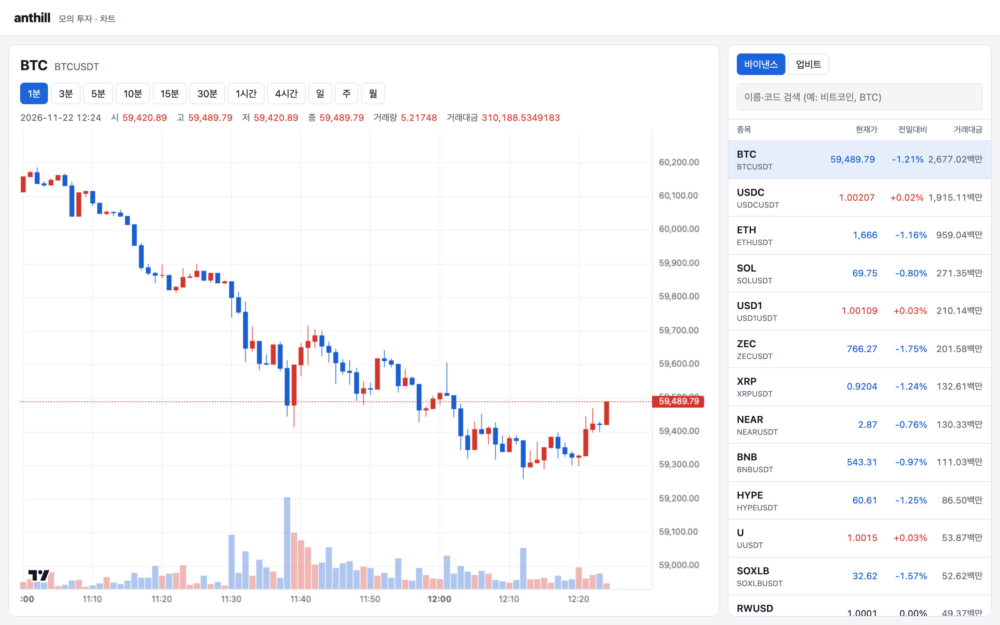
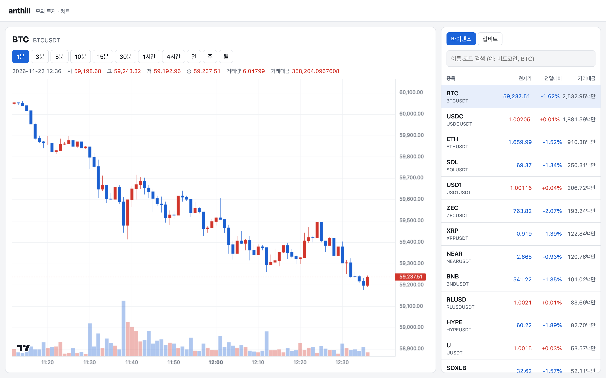
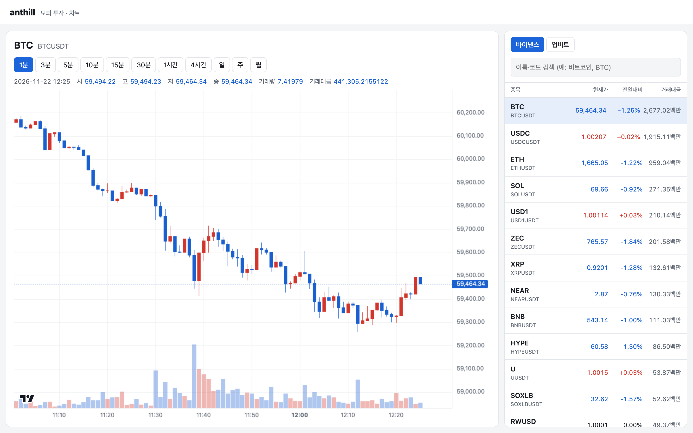
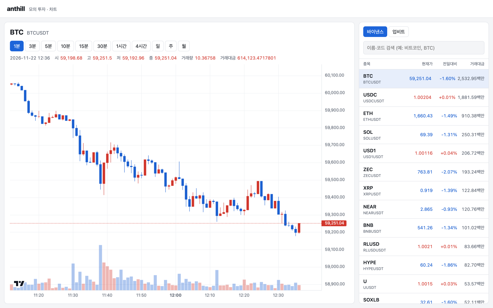

# 브라우저 실시간 연결 하트비트 (ws-heartbeat) 보고서

- 종류: 변경
- 작업 브랜치: `worktree-ws-heartbeat`
- 계획서: [plan.md](plan.md)
- 작성일: 2026-11-22

## 1. 결과 요약

게이트웨이 → 브라우저 웹소켓(`/ws`)이 "반쯤 끊긴" 상태를 이제 알아채고 스스로 회복한다. 노트북 잠자기나 와이파이 전환 뒤가 그런 상태다.
- **게이트웨이:** 1초 동안 보낸 게 없는 연결에 `{"type":"ping"}`을 보낸다.
- **브라우저:** ping이든 데이터든 3초 동안 아무것도 못 받으면(신호를 3번 놓치면) 그 연결을 버리고 **즉시** 다시 연결한다. 그 뒤 차트와 종목 목록을 REST로 다시 받는다.
- **실제로 확인한 차이:** 게이트웨이를 8초 동안 멈춰 반쯤 끊긴 상태를 재현했다.
  - 구현 전: 브라우저가 끝까지 알아채지 못했다.
  - 구현 후: 마지막 수신 뒤 **3.18초**에 끊김으로 판정하고 바로 새 연결을 시도했다.
- **게이트웨이 재시작:** 첫 재시도가 1초 뒤에서 **0초**로 당겨졌다. 다시 붙으면 종목 목록도 새로 받는다.
- **오판 없음:** 정상 상태 2분 동안 잘못된 재연결은 0회였다.

| 항목 | 결과 |
|---|---|
| 백엔드 테스트 | 233개 통과 / 0개 실패 (게이트웨이 새 테스트 4개 포함) |
| 프론트엔드 테스트 | 42개 통과 / 0개 실패 (새 테스트 10개 포함), 타입 검사 통과 |
| E2E 시나리오 | 7단계 중 7단계 통과, 화면 오류 0건 |

## 2. 화면

### 2-A. 전·후 비교 (변경)

이번 작업은 화면 모양을 바꾸지 않는다. 그래서 전·후 캡처는 거의 같아 보인다. 차이는 연결이 언제 끊기고 다시 생겼는지에 있고, 그 근거는 E2E가 단계마다 남긴 `.txt` 기록이다.

#### 게이트웨이를 8초 동안 멈춤 (반쯤 끊김 재현)

| 전 (main) | 후 (이 작업) |
|---|---|
|  |  |

시각은 모두 "멈춘 시각" 기준이다.

| | 전 ([기록](shots/before/04-half-open-pause.txt)) | 후 ([기록](shots/after/04-half-open-pause.txt)) |
|---|---|---|
| 끊김 판정 | 없음 | **2995ms `stale`** (마지막 수신 뒤 3183ms) |
| 새 웹소켓 | 없음 (옛 연결을 그대로 믿음) | 3001ms(즉시 재시도). 이 시도는 멈춘 게이트웨이에 걸렸다가 8003ms에 5초 제한(`connect-timeout`)으로 버려졌다. 8824ms에 다시 시도해 붙었다 |
| 최신 캔들 재조회 | 없음 | 8835ms |
| 풀린 뒤 실시간 갱신 | 다시 됨 (옛 연결이 살아 있어서) | 다시 됨 (새 연결로) |

- **구현 전:** 이번 재현은 게이트웨이 프로세스만 멈춘 경우라, 풀리자 옛 연결이 되살아났다. 실제 와이파이 전환이나 잠자기에서는 옛 연결이 영영 돌아오지 않는다. 그러면 브라우저는 차트가 멈춘 채로 수 분에서 1시간을 기다린다.
- **구현 후:** 3초 판정으로 바로 버리고 다시 붙는다.

#### 게이트웨이 재시작

| 전 (main) | 후 (이 작업) |
|---|---|
|  |  |

시각은 모두 "재시작 명령" 기준이다.

| | 전 ([기록](shots/before/05-gateway-restart.txt)) | 후 ([기록](shots/after/05-gateway-restart.txt)) |
|---|---|---|
| 끊긴 뒤 첫 재시도 | 1002ms 뒤 | **0ms 뒤** |
| 재시도 시각 | 1169, 3177, 7182ms (1→2→4초) | 187, 1097, 2834, 6364ms (즉시, 이후 지터가 섞인 백오프) |
| 종목 목록 재조회 | **없음** | 6553ms |
| 최신 캔들 재조회 | 7210ms | 6553ms |

게이트웨이가 다시 뜨는 데 약 6초가 걸려 그동안의 재시도는 실패한다. 구현 후에는 첫 시도를 즉시 하고, 실패하면 무작위 편차를 섞은 간격으로 늘린다. 다시 붙은 뒤에는 종목 목록도 새로 받아 끊긴 동안 놓친 가격을 맞춘다.

#### 이번 작업으로 새로 확인한 동작 (전 화면 없음)

| 단계 | 결과 |
|---|---|
| 구독 없는 연결도 ping을 받는다 ([기록](shots/after/02-idle-ping.txt)) | 6초 동안 ping 5개, 간격 997~1252ms. 첫 ping은 열린 뒤 1251ms |
| 정상 2분 ([캡처](shots/after/03-steady-2min.png), [기록](shots/after/03-steady-2min.txt)) | 재연결 0회, 새 웹소켓 0개, 범례 변화 113번, 받은 ping 10개. 데이터가 흐르는 동안에는 ping이 거의 나가지 않는다 |
| 네트워크 끊김 → 복귀 ([캡처](shots/after/06-network-online.png), [기록](shots/after/06-network-online.txt)) | 온라인이 된 0ms에 `online`으로 바로 새 연결. 헤드리스 Chrome이 `online` 이벤트를 스스로 냈다(직접 내지 않음) |

## 3. 어떻게 구현했나

| 파일 | 한 일 |
|---|---|
| [`StreamWebSocketHandler.kt`](../../../backend/services/edge-gateway/src/main/kotlin/com/anthill/gateway/realtime/StreamWebSocketHandler.kt) | 세션별 `Outbox`에 마지막으로 보낸 시각(`lastSentAt`)을 둔다. `heartbeat()`가 1초 넘게 보낸 게 없는 세션에 `{"type":"ping"}`을 기존 `send()`로 보낸다. 그래서 세션별 대기열과 밀림 한도(`maxPending`) 보호를 그대로 받는다. 시각은 주입한 `Clock`으로 읽는다 |
| [`HeartbeatTicker.kt`](../../../backend/services/edge-gateway/src/main/kotlin/com/anthill/gateway/realtime/HeartbeatTicker.kt) (새 파일) | 250ms마다 `heartbeat()`를 부른다. 정상일 때 메시지 사이 공백이 최대 약 1.25초가 된다(E2E에서 실측 최대 1252ms) |
| [`GatewayConfig.kt`](../../../backend/services/edge-gateway/src/main/kotlin/com/anthill/gateway/config/GatewayConfig.kt), `application.yml` | `anthill.ws.heartbeat-idle`(기본 1초) 설정을 추가하고 `HeartbeatTicker` 빈을 등록했다 |
| `src/test/resources/application.properties` | 기존 통합 테스트는 "아무것도 오지 않는다"를 확인한다. ping이 끼어들지 않게 `heartbeat-idle=1h`로 둔다 |
| [`stream.ts`](../../../frontend/src/api/stream.ts) | 아래 표 참고 |
| [`MarketList.tsx`](../../../frontend/src/markets/MarketList.tsx) | 다시 붙으면 `fetchMarkets()`로 목록을 새로 받는다. 첫 조회 실패로 오류가 떠 있었어도 이때 받으면 정상으로 돌아온다 |

**`stream.ts`에서 바뀐 것**
- **받은 시각 기록:** 메시지(ping 포함)를 받을 때마다 받은 시각을 적는다.
- **무소식 판정:** 0.5초마다 확인해서 3초 동안 아무것도 없으면 `stale`로 끊는다.
- **재시도 간격:** 실패 횟수로 계산한다. 0번째는 0초, 그 뒤는 `1초 × 2^(n−1)`(최대 30초)에 `× (0.5~1)` 무작위 편차를 곱한다.
- **실패 횟수 초기화:** 열린 뒤 첫 메시지를 받았을 때 0이 된다. 받자마자 끊는 서버에 즉시 재시도를 끝없이 반복하지 않게 하려는 것이다.
- **연결 시도 제한:** 5초 안에 열리지 않으면 버린다.
- **새 공개 메서드:** `reconnectNow()`와 `checkNow()`. `sharedStream()`에서 `online`과 `visibilitychange`(보임)에 연결했다.
- **소켓 버리기:** 핸들러를 먼저 떼고 닫는다. 늦게 오는 이벤트가 아무것도 하지 않게 하려는 것이다.
- **재연결 로그:** 재연결 때마다 `console.info('[stream] reconnect', 이유)`를 남긴다.

**계획과 달라진 점**
- **E2E 7단계:** 계획서에서는 "result.json의 화면 오류가 비어 있다"를 끝에 확인하기로 했다. 이것을 시나리오 안의 단계(`no-page-errors`)로 만들었다. 확인하는 내용은 같다.
- **E2E 4단계 상한:** 계획서 7절은 판정 시점을 "3000~3600ms"로 적었고, 그대로 썼다(실측 3183ms).
- **첫 "후" E2E 실행 실패:** `docker compose up --build`가 백엔드 서비스를 모두 다시 띄웠다. marketdata가 캔들을 다 채우기 전에 시작해서 첫 화면의 차트가 비어 실패했다. 이번 변경과는 관계없다. 캔들 API가 정상 응답하는 것을 확인하고 다시 실행해 7단계 모두 통과했다.

## 4. 테스트

사용자가 확인한 목록대로 썼다. 새 테스트 이름과 주석은 한국어다.

**프론트엔드** ([`stream.test.ts`](../../../frontend/src/api/stream.test.ts))

| 확인한 것 | 테스트 | 결과 |
|---|---|---|
| (기존, 기대값 바뀜) 끊기면 0초 뒤 다시 연결, 구독 재전송, `onReconnect` | `stream resubscribes after reconnect` | 통과 |
| (기존, 바뀜) 대기 `[0, 1000, 2000, 4000, 8000, 16000, 30000, 30000]`, 첫 메시지에서 처음으로 | `끊기면 첫 재시도는 즉시, …` | 통과 |
| 3초 무소식이면 버리고 즉시 재연결. 옛 소켓은 닫히고 핸들러가 떼어짐 | `열린 뒤 3초 동안 아무것도 안 오면 …` | 통과 |
| ping이 1초마다 오면 10초 동안 재연결 없음. ping은 리스너에 안 감 | `ping이 1초마다 오면 …` | 통과 |
| 2.9초에는 그대로, 3.5초 안에는 재연결 | `마지막 수신 뒤 2.9초에는 …` | 통과 |
| 메시지 없이 열렸다 닫히기 반복 → 0, 1000, 2000ms | `메시지 없이 열렸다 닫히기를 되풀이하면 …` | 통과 |
| 무작위 값 0 → 0, 500, 1000, 2000ms | `무작위 값이 0이면 대기가 절반이 된다` | 통과 |
| 4.999초에는 기다리고 5초에 `connect-timeout` | `5초 동안 열리지 않으면 …` | 통과 |
| `reconnectNow()`는 대기를 건너뛰고, 열린 소켓도 버림 | `reconnectNow()는 …` | 통과 |
| `checkNow()`의 네 경우(연결 중, 대기 중, 3초 안, 3초 넘음) | `checkNow()는 …` | 통과 |
| `close()` 뒤에는 모두 멈춤 | `close() 뒤에는 …` | 통과 |
| 버린 소켓의 늦은 이벤트는 무시 | `버린 소켓에 늦게 …` | 통과 |

참고: vitest 가짜 타이머는 타이머 콜백 안에서 예약한 0초 타이머를 1ms 뒤로 민다. 그래서 무소식 판정이나 연결 제한 뒤의 즉시 재시도는 테스트에서 1ms를 더 돌려 확인한다. 실제 브라우저에서는 0초다.

**게이트웨이** ([`StreamWebSocketHandlerSendTest.kt`](../../../backend/services/edge-gateway/src/test/kotlin/com/anthill/gateway/realtime/StreamWebSocketHandlerSendTest.kt), 테스트가 직접 옮기는 시계 사용)

| 확인한 것 | 테스트 | 결과 |
|---|---|---|
| 1초 동안 보낸 게 없는 세션에만 ping. 0.999초에는 없음 | `1초 동안 보낸 게 없는 세션에만 ping을 보낸다` | 통과 |
| 데이터 뒤 1초에 ping, ping 뒤 다시 1초를 셈 | `데이터를 보낸 세션도 1초가 지나면 …` | 통과 |
| 막힌 세션은 쌓인 ping이 한도를 넘으면 끊기고 구독에서 빠짐 | `쓰기가 막힌 조용한 세션은 …` | 통과 |
| 닫힌 세션에는 ping 없음 | `닫힌 세션에는 ping을 보내지 않는다` | 통과 |
| 기존 통합 테스트가 `heartbeat-idle=1h`로 그대로 통과 | `StreamWebSocketHandlerTest` 전체 | 통과 |

실행한 명령과 마지막 출력:

```text
$ bash .claude/skills/work-test/run-tests.sh
▶ 백엔드 테스트 (gradlew test)
BUILD SUCCESSFUL in 41s
(테스트 결과 파일 집계: 233개 실행, 실패 0)

$ bash .claude/skills/work-test/run-tests.sh frontend   (테스트 파일 타입 오류를 고친 뒤 다시 실행)
 Test Files  6 passed (6)
      Tests  42 passed (42)
=== 테스트 결과 ===
통과 | 프론트엔드 테스트 (vitest run, tsc -b)
```

처음 전체 실행에서는 프론트엔드 `tsc -b`가 테스트 파일의 타입 하나 때문에 실패했다. `console.info`를 감시하는 변수에 정확한 타입을 주고 프론트엔드를 다시 실행해 통과했다. 백엔드는 그 수정과 관계없다.

## 5. E2E

시나리오 파일: [e2e.mjs](e2e.mjs). 컨테이너 전체 실행(`docker compose up -d --build`), 주소는 http://localhost:3000 (nginx를 거치는 실제 경로)이다. 게이트웨이 조작은 `docker compose pause|unpause|restart edge-gateway`로 했다. `console.info`와 `WebSocket`을 감싸는 감시 코드를 화면이 열리기 전에 넣어 재연결 이유와 시각을 기록했다.

| 순서 | 사용자가 한 일 | 기대한 결과 | 실제 결과 | 캡처 |
|---|---|---|---|---|
| 1 | 첫 화면을 연다 | 목록과 차트, 웹소켓 1개 | 통과 | [01-first-screen.png](shots/after/01-first-screen.png) |
| 2 | 구독 없이 `/ws`에 붙어 6초 둔다 | ping 4개 이상, 간격 1.5초 이하 | 통과 (5개, 최대 1252ms) | [02-idle-ping.txt](shots/after/02-idle-ping.txt) |
| 3 | 2분 동안 그대로 둔다 | 재연결 0회, 범례 60번 이상 변화 | 통과 (0회, 113번) | [03-steady-2min.png](shots/after/03-steady-2min.png) |
| 4 | 게이트웨이를 8초 멈췄다 푼다 | 3.0~3.6초에 `stale`, 풀린 뒤 갱신 재개, 캔들 재조회 | 통과 (3183ms) | [04-half-open-pause.png](shots/after/04-half-open-pause.png) |
| 5 | 게이트웨이를 재시작한다 | `closed` 뒤 200ms 안에 재시도, 목록·캔들 재조회, 가격 다시 변화 | 통과 (0ms) | [05-gateway-restart.png](shots/after/05-gateway-restart.png) |
| 6 | 2초 오프라인 → 온라인 | 1초 안에 `online` 재연결, 10초 안에 갱신 재개 | 통과 (0ms) | [06-network-online.png](shots/after/06-network-online.png) |
| 7 | 끝 | 화면 오류 없음 | 통과 (0건) | — |

구현 전(`before`) 실행에서는 1·4·5단계를 돌렸고 모두 "지금 동작" 기대대로 통과했다(멈춘 동안 새 연결 없음, 첫 재시도 1초, 목록 재조회 없음).

## 6. 남은 것

- **연결 상태 배지와 수동 재연결 버튼:** 이번 범위에서 뺐다. marketdata만 죽은 경우처럼 연결은 살아 있는데 데이터가 멈춘 상황은 여전히 화면에 드러나지 않는다. 브라우저는 ping을 받으므로 "연결 정상, 데이터 지연"을 구별할 수 있는 상태가 이미 갖춰졌다. 다음 작업에서 배지로 보여 줄 수 있다.
- **재연결 지표:** 지금은 브라우저 콘솔 로그로만 남는다. 운영에서 오판률을 보려면 게이트웨이 쪽 지표가 필요하다(예: 보낸 ping 수, 정리된 연결 수).
- **E2E 준비 대기:** 전체를 다시 띄운 직후에는 marketdata가 캔들을 채우는 동안 차트가 빌 수 있다. E2E 첫 단계 전에 캔들 API가 데이터를 돌려줄 때까지 기다리게 하면 더 안정적이다.
